# Software Architecture Design Specification (SADS)

**Product:** Portfolio site of S. Jeevanandham, Senior HMI Engineer (https://jeevanandhamsivasankar.github.io)
**Document ID:** SADS  |  **Version:** 1.1  |  **Date:** 2026-10-11
**Status:** Updated to SRS v1.1 (baselined by the Product Owner, `docs/reviews/SRS_PO_REVIEW.md`)

### Change history

| Version | Date | Change |
|---|---|---|
| 1.0 | 2026-10-11 | Initial architecture specification: views, ARC-001..ARC-020, patterns, domain model, ADR-001..ADR-016, migration plan. |
| 1.1 | 2026-10-11 | Aligned with SRS v1.1. **ADR-011 rewritten:** the corrected solar longitude sign (+0.1487 h), the IST-midnight day-of-year and time-zone-safe IST (FR-THEME-002) are now fixed in this release rather than preserved. **New ADRs:** ADR-017 (theme applied before first paint), ADR-018 (persisted manual theme override, `jsv-theme-override`), ADR-019 (visibility-gated speedometer loop, NFR-PERF-006), ADR-020 (skip link and `:focus-visible` indicator, NFR-A11Y-008/009), ADR-021 (IntersectionObserver fallback for reveal, NFR-RELI-005). **New units:** `src/lib/storage.js` (in ARC-007) and `src/hooks/useInView.js` (in ARC-009). **Updated:** runtime views 4.4.1 and 4.4.2, new view 4.4.6 (gauge visibility gate), ARC-002, ARC-003, ARC-007, ARC-009, ARC-013, ARC-014, ARC-017, section 8 (state, error handling, accessibility, security), ADR-014 (`si:` alt text stays the slug per NFR-A11Y-004), ADR-015, the migration steps and the risks. New findings P-23 to P-25. |
**Authoritative input:** `docs/ARCHITECTURE_BRIEF.md`. Where this document and the brief disagree, the brief wins and this document must be corrected.

---

## Table of contents

1. [Introduction](#1-introduction)
2. [Architectural drivers and quality attributes](#2-architectural-drivers-and-quality-attributes)
3. [Current-state assessment of the monolith](#3-current-state-assessment-of-the-monolith)
4. [Architecture views](#4-architecture-views)
5. [Architecture elements catalogue (ARC)](#5-architecture-elements-catalogue-arc)
6. [Design patterns applied](#6-design-patterns-applied)
7. [Domain model](#7-domain-model)
8. [Cross-cutting concerns](#8-cross-cutting-concerns)
9. [Architecture Decision Records (ADR)](#9-architecture-decision-records-adr)
10. [Migration plan, risks and mitigations](#10-migration-plan-risks-and-mitigations)

---

## 1. Introduction

### 1.1 Purpose

This document describes the software architecture of the portfolio single-page application. It covers the architecture after the redesign: the module layout, the layering and dependency rules, the runtime behaviour, the deployment, the design patterns, the domain model and the architecture decisions. It also assesses the current monolithic implementation and gives an ordered migration plan from the monolith to the target.

Readers:

- **Implementers** who refactor `src/App.jsx` into the target layout.
- **Reviewers and test engineers**, who trace requirements to architecture elements (`ARC-NNN`) and then to units and test cases.
- **Maintainers** who will add content or sections later.

### 1.2 Scope

In scope:

- All code under `src/`.
- The HTML shell `index.html` and the static assets in `public/`.
- Build, lint and test configuration (`vite.config.js`, `eslint.config.js`, test configuration).
- The CI workflow (`.github/workflows/ci.yml`) and the deployment path to GitHub Pages.

Out of scope:

- The content of the resume PDF and of the Behance profile.
- Hosting infrastructure. GitHub Pages is treated as a black box.
- Visual redesign. The acceptance bar is pixel-level parity with the current site.

### 1.3 Definitions and abbreviations

| Term | Meaning |
|---|---|
| ARC-NNN | Architecture element identifier defined in this document |
| ADR-NNN | Architecture Decision Record identifier defined in this document |
| UNIT-<NAME> | Unit identifier defined in SUDS.md (one unit per source file) |
| FR-<AREA>-NNN / NFR-<CAT>-NNN | Functional and non-functional requirement identifiers defined in SRS.md |
| UT-/IT-/QT- | Unit, integration and qualification test case identifiers defined in STP.md |
| Below the fold | Sections that are not visible in the first viewport. That is every section after Hero. |
| Parity | The same CSS rules and values, markup class names, text content and behaviour as the monolith baseline (commit `dd9a86d`) |
| Monolith | The current `src/App.jsx`: 2,469 lines in one module |

### 1.4 References

| Ref | Document | Relationship |
|---|---|---|
| [BRIEF] | `docs/ARCHITECTURE_BRIEF.md` | Authoritative target layout, patterns, constraints and test strategy |
| [SRS] | `docs/SRS.md` (SRS-PORTFOLIO-001 v1.1, Baselined) | Requirements. Functional areas: NAV, HERO, ABOUT, EXP, SKILL, PROJ, DESIGN, EDU, CERT, RES, CONT, THEME, FX, GEN. NFR categories: PERF, A11Y, SEC, MAINT, PORT, USAB, RELI, SEO, DEPLOY. |
| [PO-REV] | `docs/reviews/SRS_PO_REVIEW.md` | Product Owner decisions F-01..F-24 and OBS-1..OBS-19 that this version implements |
| [SUDS] | `docs/SUDS.md` | Unit design. Each unit belongs to exactly one ARC element in section 5. |
| [STP] | `docs/STP.md` | Test plan and the traceability matrix Requirement -> ARC -> UNIT -> TC |
| [WCAG] | WCAG 2.1 Level AA | Accessibility target |
| [ASPICE] | Automotive SPICE SWE.4 / SWE.5 / SWE.6 | Test level structure |

SUDS and STP are being written at the same time as this document. This document mostly refers to requirement **areas** (for example "FR-THEME-*"). From v1.1 it also cites individual SRS v1.1 IDs where an ADR implements a specific baselined requirement (for example FR-THEME-008 or NFR-PERF-006).

---

## 2. Architectural drivers and quality attributes

### 2.1 Business and functional drivers

| Driver | Source | Architectural consequence |
|---|---|---|
| A recruiter or hiring manager gets a first impression in a few seconds | FR-HERO-*, NFR-PERF-* | Hero, Nav and the effects layer stay in the initial bundle. Everything below the fold is lazy loaded (ADR-005). |
| Content changes often: new roles, projects, certifications | NFR-MAINT-* | Content lives in data modules built through validated model factories (ADR-009, ADR-010). Adding a section takes one registry entry (ADR-004). |
| The site has to read as an HMI engineer's work: gauge, day/night theme, motion | FR-FX-*, FR-THEME-* | Effects and widgets are isolated components (ARC-012, ARC-013). The theme is a first-class application service (ARC-008). |
| The redesign must not change look or behaviour | BRIEF "Non-functional constraints" | Parity is verified by DOM-snapshot and CSS-equivalence tests in the migration (section 10). Class names and CSS values do not change. |

### 2.2 Quality attribute scenarios

| ID | Attribute (NFR category) | Stimulus | Response / measure |
|---|---|---|---|
| QA-1 | Performance (PERF) | First visit on a cold cache | The initial JS chunk (gzip) is no larger than the monolith baseline of **84.79 kB gzip / 304.14 kB raw**, measured from `vite build` at `dd9a86d`. CSS ships as a separate render-blocking stylesheet. |
| QA-2 | Performance (PERF) | The page runs idle in a background tab or below 900 px, where the gauge is hidden | No animation loop runs while it is not visible. The Speedometer schedules no `requestAnimationFrame` and causes no re-render while it is hidden by CSS, scrolled out of view or in a hidden tab (NFR-PERF-006, ADR-019, section 4.4.6). |
| QA-3 | Maintainability (MAINT) | The owner adds a new project | Exactly one object literal is added in `src/data/projects.js`. A validation error names the field if the data is malformed. |
| QA-4 | Maintainability (MAINT) | A developer adds a new section | One file is added in `src/sections/` and one entry in `src/config/sections.js`. Nav and page order update automatically. |
| QA-5 | Testability (MAINT) | Solar theme logic must be verified for a given date | `lib/solar.js` is a pure function of `(Date)`. No DOM or React is needed (ADR-011). |
| QA-6 | Reliability (RELI) | A lazy chunk fails to load (network error, or stale hash after a redeploy) | Only that section shows a fallback with a reload action. The rest of the page stays usable (ARC-015, ADR-005). |
| QA-7 | Reliability (RELI) | The Simple Icons CDN is unreachable | Each chip falls back to the Material Symbols `code` glyph. Layout is unchanged (ADR-014). |
| QA-8 | Accessibility (A11Y) | The user has `prefers-reduced-motion: reduce` set | CSS animations are neutralised (current behaviour). JS-driven motion (speedometer, parallax, cursor glow, typewriter) is also suppressed (ADR-015). |
| QA-9 | Security (SEC) | A user clicks an external link | Every `target="_blank"` link carries `rel="noopener noreferrer"`. No secrets exist in the bundle. A CSP meta tag restricts origins (ADR-013). |
| QA-10 | Portability (PORT) | Recent Chrome, Firefox, Safari or Edge, desktop or mobile | The layout adapts at the existing 900 px and 540 px breakpoints. `IntersectionObserver` and `matchMedia` are feature-detected with graceful fallbacks. |
| QA-11 | SEO (SEO) | A crawler fetches `/` | `index.html` keeps the title, description, canonical, OG and Twitter metadata unchanged. Hero content renders on the first client render without waiting for lazy chunks. |
| QA-12 | Deployability (DEPLOY) | A release is made | `npm run lint`, `npm test` and `npm run build` pass in CI. `npm run deploy` publishes `dist/` to `gh-pages` with base `/` unchanged. |

### 2.3 Constraints

- **C-1** React 19, Vite 7 and plain JavaScript (JSX). ESLint 9 flat config.
- **C-2** No new runtime dependencies. Allowed dev dependencies are vitest, @testing-library/react, @testing-library/jest-dom and jsdom, plus @playwright/test for qualification testing under the brief's test strategy (ADR-016).
- **C-3** GitHub Pages hosting. It serves static files only. Custom HTTP response headers are not possible, the CDN caches with `max-age=600`, and there is no server-side rendering.
- **C-4** Deployment is unchanged: `gh-pages -d dist`, `base: '/'`.
- **C-5** Visual and behavioural parity with the monolith.

---

## 3. Current-state assessment of the monolith

All line references are to `src/App.jsx` at commit `dd9a86d` (2,469 lines). Lint passes and the build produces a single JS chunk: `dist/assets/index-*.js` at 304.14 kB, 84.79 kB gzip.

### 3.1 Structural overview of the monolith

| Lines | Content |
|---|---|
| 6-917 | `CSS` template string, about 910 lines: tokens, base, keyframes, components, sections, responsive rules and reduced-motion rules |
| 924-1051 | Hooks: `useTheme`, `useReveal`, `useActiveSection`, `useScrolled`, `useTypewriter`, `useParallax` |
| 1056-1069 | Primitives: `Ms` (icon), `SL` (section label), `ST` (section title) |
| 1074-1118 | Data: `NAV`, `STATS`, `EXPERIENCE` |
| 1126-1486 | Tech icon system: `CUSTOM_SVGS` (30 keys), `TechIcon`, `SkillChip` |
| 1491-1670 | Data: `SKILL_CATEGORIES`, `PROJECTS`, `CERTS` |
| 1675-1816 | Effects and widgets: `GradientOrbs`, `CursorGlow`, `PARTICLES` / `Particles`, `Speedometer` |
| 1821-2426 | `Nav`, `Hero` (+`HERO_ROLES`), `About`, `Experience`, `Skills`, `Projects`, `DESIGN_CARDS` + `Design`, `Education`, `Certifications`, `Resume`, `Contact` |
| 2431-2469 | `App`: injects the `<style>`, renders the layout and the footer |

### 3.2 Problems found

| # | Problem | Evidence (lines) | Impact | Resolved by |
|---|---|---|---|---|
| P-01 | **Single module with no separation of concerns.** Styles, data, logic and presentation share one file. | 1-2469 | Hard to review, test or change in isolation. Any edit re-bundles everything. | Layered layout (section 4.2), ARC-001..ARC-020 |
| P-02 | **CSS injected as a JS string.** `<style>{CSS}</style>` is rendered by `App`, so no styles exist until JS has executed. The string is part of the JS bundle and is re-reconciled on every `App` render (every theme toggle). | 6-917, 2437 | No CSS before JS. CSS is not cacheable apart from JS. A strict CSP would need `style-src 'unsafe-inline'`. | ADR-002, ARC-017 |
| P-03 | **`useReveal` effect has no dependency array.** It creates a new `IntersectionObserver` and re-queries `document.querySelectorAll(".reveal")` after **every** `App` render. It only runs when `App` re-renders, so elements mounted later by a child, such as a lazy section resolving, are never observed. | 967-976 (no deps at 975), 2433 | Wasted work today. With code splitting, below-the-fold content would stay at `opacity: 0` permanently. | ADR-012, ARC-009 (`useReveal(rootRef)`) |
| P-04 | **Theme attribute applied in `useEffect`.** `data-theme` is set after the first paint, so day-time visitors see the night palette (`:root` default) for one frame. | 955-957 | Theme flash. | ADR-017 (FR-THEME-001) |
| P-05 | **Solar correction sign error.** The comment says "+0.18h", but `(80.27 / 15) - 5.5` evaluates to about **-0.149 h**. For Chennai, local solar noon in IST is about 12:09, so the correction should be about +0.149 h. Day/night switches about 18 minutes off, before even accounting for the equation of time. | 941-943 | Theme switches about 18 min early. | **Fixed in this release** per SRS v1.1 FR-THEME-002 step 6 (OBS-16). See ADR-011. |
| P-06 | **Impure, non-deterministic data.** `PARTICLES` uses `Math.random()` at module load, and `useTypewriter` adds `Math.random() * 30` jitter. | 1709-1719, 1016 | Rendered output cannot be snapshotted. Particle positions differ on each load. | ADR-007, `lib/random.js` |
| P-07 | **Re-render storms.** `Speedometer` calls two `setState`s per animation frame, about 60 renders per second, indefinitely. It keeps running when the gauge is hidden (`.hero-center { display: none }` below 900 px) or off-screen. `CursorGlow` calls `setState` on every `mousemove`. | 1743-1753, 888, 1690-1695 | CPU and battery drain, especially on mobile where the gauge is invisible. | Section 8.6, ADR-015 |
| P-08 | **`Ms` drops `className`.** `Nav` passes `className="ms"`, but `Ms` does not forward it. The CSS rules `.nav-link .ms`, `.theme-btn .ms`, `.theme-btn:hover .ms` and `.btn .ms` never match. | 1056-1063, 1840, 249-250, 289, 440 | Dead CSS, and the visible behaviour differs from what the CSS intends. | Recorded. Parity requires keeping the current visual result, so `Icon` does **not** add `.ms` automatically (see risk R-2). |
| P-09 | **Material Symbols ligature text is exposed to assistive technology.** Icon spans have no `aria-hidden`, so screen readers announce "rocket_launch", "open_in_new" and so on. | 1056-1063 (all usages) | A11Y defect (WCAG 1.1.1 / 1.3.1). | `Icon` renders `aria-hidden="true"` by default (ARC-010). This does not change visible output. |
| P-10 | **Nav accessibility gaps.** The hamburger has no `aria-expanded` or `aria-controls`. The theme toggle has no pressed or state semantics. `<nav>` has no accessible name. | 1832, 1852, 1856 | A11Y | ARC-014 |
| P-11 | **Stale clock in theme badge.** `timeStr` is computed at render time and only refreshes when `Nav` happens to re-render on scroll changes. | 1827-1828 | The displayed time drifts. | A 60 s clock tick in `useTheme` that runs whether or not an override is active (FR-THEME-005, ARC-009) |
| P-12 | **Duplicated content facts.** "4.9+" years appears 6 times. Email, phone and the Behance URL are each hard-coded at least twice. The resume path appears 5 times. The gauge stats duplicate `STATS`. | 1087, 1904, 1926, 1990, 2239, 2307; 2374, 2415-2416; 2267, 2420; 1914, 2361, 2364, 2389, 2393; 1925-1936 | Inconsistency risk on update. | `config/site.js` and `data/profile.js` as the single source (ARC-003, ARC-006) |
| P-13 | **JSX inside data.** Each `DESIGN_CARDS[].art` is a JSX SVG tree, and `CUSTOM_SVGS` maps keys to JSX factories. | 2146-2257, 1126-1434 | Data cannot be pure, so models cannot be React-free. | Registry by key: `artKey` and `svg:` keys (ADR-004, section 6.4) |
| P-14 | **Content hard-coded in markup.** Education cards, the ISO 26262 strip, hero badges, the profile panel, contact links and the footer text are literals inside JSX. | 2294-2313, 2079-2098, 1907, 1963-1972, 2415-2423, 2464 | Content edits require editing presentation code. | ARC-006 data modules |
| P-15 | **Imperative DOM mutation for hover.** `onMouseOver`/`onMouseOut` write `e.currentTarget.style`. | 1998-1999, 2116-2117, 2390, 2394 | Bypasses React. Hard to test. | Kept for parity, encapsulated in presentational components (section 8.2). A CSS custom-property approach is a later option. |
| P-16 | **Order and nav defined separately.** The `NAV` array (1074-1084), the `App` JSX order (2442-2460) and the hard-coded labels "01 — About" ... "09 — Contact" in each section must be kept in sync manually. | 1074-1084, 2442-2460, 1986 ... 2411 | Adding or reordering a section touches at least 3 places. | Section registry (ADR-004) |
| P-17 | **Scroll handlers are not throttled.** `useActiveSection` walks every `[data-section]` and reads `offsetTop` on every scroll event. That layout read can force reflow. | 980-989 | Scroll jank on low-end devices. | rAF-coalesced handler (ARC-009) |
| P-18 | **No error containment.** There is no Error Boundary. Any render error blanks the whole page. | `src/main.jsx` | Reliability | ARC-015 |
| P-19 | **Runtime third-party dependency.** Tech icons load from `https://cdn.simpleicons.org/<slug>`, with `alt={slug}` even though the visible label already names the skill. | 1445, 1449 | Privacy, availability and CSP surface. | ADR-014. `alt` stays the slug, as NFR-A11Y-004 requires. |
| P-20 | **No tests. CI runs only lint and build.** | `.github/workflows/ci.yml` | Regressions are undetected. | ADR-006, ADR-016, ARC-019, ARC-020 |
| P-21 | **Inline style objects recreated per render.** Examples: Education tags, resume preview rows and links, and `Resume.BARS` defined inside the component. | 2310, 2346-2351, 2375, 2380, 2389-2396 | Minor performance cost. Styling is scattered. | Data moved to modules. Inline styles kept as-is for parity in the first pass. |
| P-22 | **Inconsistent section root elements.** Experience, Design, Certifications and Resume use `<div>` and the others use `<section>`. | 2016, 2261, 2324, 2353 | Weaker landmark semantics | The `Section` wrapper takes an `as` prop. The current element type is preserved for parity. Switching to `<section>` is CSS-safe, because CSS targets classes, and is recorded as an optional A11Y improvement. |
| P-23 | **Day-of-year rolls over at about 12:00 IST and IST is derived from the browser time zone.** `Math.round((istDate - start) / 86400000)` with `start = new Date(year, 0, 0)` changes value around noon. `getTimezoneOffset()` plus local getters can be off by an hour near a DST change in the visitor's zone. | 928-932 | Wrong day number for half of each day. Time-zone-dependent result. | Fixed per FR-THEME-002 steps 1-2 (OBS-2, F-03). See ADR-011. |
| P-24 | **No skip link and browser-default focus rings.** Keyboard users tab through 12 nav controls, and the default ring is weak on the dark glass nav. | 1832-1872 (nav), CSS 6-917 (no `:focus-visible` rule) | WCAG 2.4.1 / 2.4.7 gaps | ADR-020 (NFR-A11Y-008, NFR-A11Y-009) |
| P-25 | **Inconsistent resume download filenames.** The Hero CTA (1914) and the preview "Download" link (2389) use a bare `download` attribute. Only 2361 sets `Jeevanandham_SeniorHMIEngineer_Resume.pdf`. | 1914, 2361, 2389 | A recruiter gets differently named copies. | All three use `RESUME.downloadName` from ARC-003 (FR-HERO-007, FR-RES-003, F-02) |

Several things are already good and are preserved: `prefers-reduced-motion` CSS (908-916), `rel="noopener noreferrer"` on every `target="_blank"` (2267, 2364, 2393, 2419-2421), the `aria-hidden` decorative layers (1677, 1700), the profile image with intrinsic size, `decoding="async"` and an `onError` fallback (1954-1961), and SEO metadata in `index.html`.

---

## 4. Architecture views

### 4.1 Context view

The system is a static client-side SPA. It has no backend. All external interactions are browser navigations or asset fetches.

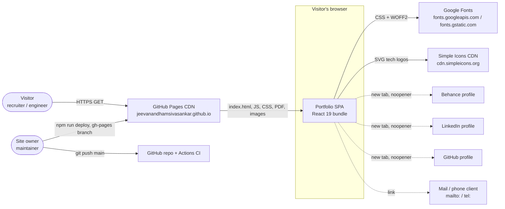

| External entity | Interface | Failure behaviour |
|---|---|---|
| GitHub Pages | Static HTTPS (HTML, hashed JS/CSS under `/assets/`, `/profile.webp`, `/Jeevanandham_Resume.pdf`, `/favicon.svg`, `/profile-og.jpg`) | The site is down. Nothing can be done at app level. |
| Google Fonts | `<link rel="stylesheet">` in `index.html` with `display=swap` | Fallback fonts (`monospace`, `sans-serif`). Material Symbols ligatures show as text. |
| Simple Icons CDN | `` | `onError` switches to the Material Symbols `code` glyph (ADR-014) |
| Behance, LinkedIn, GitHub | Outbound `<a target="_blank" rel="noopener noreferrer">` | None (navigation only) |
| Mail and phone | `mailto:` and `tel:` anchors | Handled by the OS |

### 4.2 Logical / layer view

The architecture is a strict layered architecture. Each layer may depend only on layers below it.

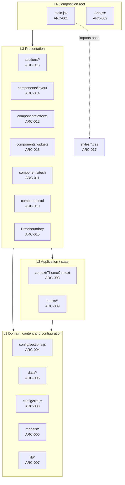

| Layer | Responsibility | Contains React? | Side effects? |
|---|---|---|---|
| L1 Domain / content / configuration | What the site says: typed, validated, immutable content. Pure algorithms. Site constants. | No. `config/sections.js` is the one exception: it uses `React.lazy` only to *declare* components. | None (pure) |
| L2 Application / state | How state evolves: theme, scroll position, visibility, timers, media queries | Hooks only | Yes. Every side effect is encapsulated here. |
| L3 Presentation | How things look: markup and class names, identical to the monolith | Yes | None of their own beyond calling hooks |
| L4 Composition root | Wires providers, boundaries, layout and the registry. Bootstraps React. | Yes | Bootstraps the DOM |

### 4.3 Module / dependency view

#### 4.3.1 Module dependency diagram

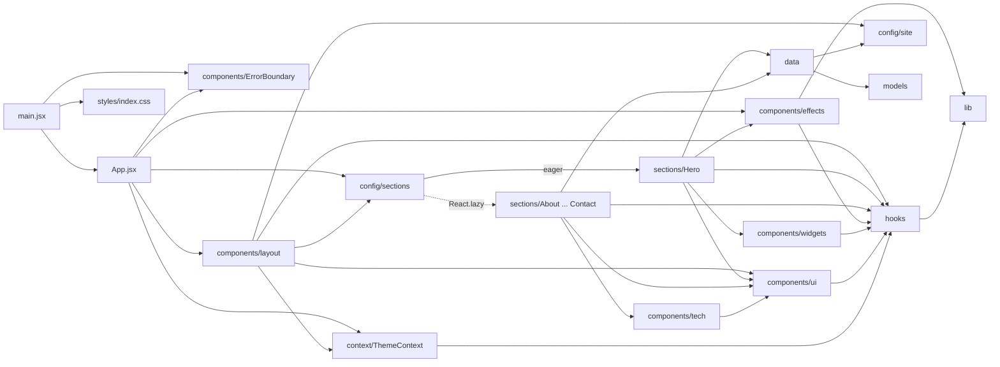

#### 4.3.2 Allowed dependency rules

> **Amendment (Release 2.0, DEF-203):** `components/effects/*` may import `react-dom` (`createPortal`) to render full-viewport overlays (theme illumination wash, ignition intro) into `document.body`. All other layers keep the rules below.

"May import" lists every allowed target. Any import not listed is forbidden. React imports are noted explicitly.

| From | May import | Must NOT import | Rationale |
|---|---|---|---|
| `models/` | `models/` (siblings, e.g. `validate.js`) | React, `data/`, `config/`, `hooks/`, `components/`, `sections/`, `lib/` | Domain core must stay pure and framework-free. It is testable in plain Node. |
| `lib/` | `lib/` (siblings); `lib/storage.js` additionally `config/site.js` (constants only, e.g. the storage key) | React, everything else | Pure functions (ADR-011, ADR-007). `storage.js` is the one guarded I/O adapter, with storage injectable (ADR-018). Amendment R1 (DEF-014): the constants-only import of `config/site.js` is allowed. |
| `config/site.js` | nothing | everything | Leaf constants |
| `data/` | `models/`, `config/site.js` | React, `hooks/`, `components/`, `sections/`, `context/` | Content is plain data validated by the factories (ADR-009) |
| `config/sections.js` | React (`lazy` only), `sections/`, `models/` | `data/`, `components/`, `hooks/` | Registry declares *what* renders. It holds no content. Amendment R1 (DEF-014): `models/` (`createModels.js`, `validate.js`) is allowed so registry entries are built and validated by the factories. |
| `hooks/` | React, `lib/`, `hooks/` | `components/`, `sections/`, `data/`, `context/` | Reusable side-effect encapsulation with no content knowledge |
| `context/` | React, `hooks/` | `components/`, `sections/`, `data/` | Application services |
| `components/ui/` | React, `hooks/`, `components/ui/` | **`data/`**, `config/`, `sections/`, `tech/`, `widgets/`, `effects/`, `layout/` | Primitives are content-agnostic and reusable |
| `components/tech/` | React, `components/ui/` | `data/`, `sections/`, `hooks/` (not needed) | Resolves icon references passed in as props |
| `components/effects/` | React, `hooks/`, `lib/` | `data/`, `sections/`, `ui/` | Decorative only |
| `components/widgets/` | React, `hooks/`, `lib/` | `data/`, `sections/` | Self-contained animated widgets |
| `components/layout/` | React, `components/ui/`, `components/ErrorBoundary`, `context/`, `hooks/`, `config/` | `data/` (except through `config/site.js`), `sections/` | Chrome around the content. Amendment R1 (DEF-014): `SectionSlot` wraps each section in `ErrorBoundary`. |
| `components/ErrorBoundary.jsx` | React, `components/ui/` | everything else | Must not depend on anything that might itself fail |
| `sections/` | React, `data/`, `config/site.js`, `components/ui`, `components/tech`, `components/widgets`, `components/effects`, `hooks/`, `context/` | other `sections/`, `config/sections.js`, `App.jsx`, `components/layout` | Containers. Sections are independent so they can be split into chunks. |
| `App.jsx` | React, `context/`, `hooks/`, `components/layout`, `components/effects`, `components/ErrorBoundary`, `components/ui`, `config/sections.js`, `config/site.js` | `data/` directly, `models/` | Composition only. Amendment R1 (DEF-014): `hooks/` allowed (`useActiveSection`). |
| `main.jsx` | React DOM, `App.jsx`, `components/ErrorBoundary`, `config/site.js`, `styles/index.css` | everything else | Bootstrap. Amendment R1 (DEF-014): `config/site.js` allowed (fallback contact data). |
| `styles/*.css` | other `styles/*.css` via `@import` (only `index.css`) | JS | Imported exactly once, from `main.jsx` |

General rules:

- **R-ACYCLIC.** There must be no import cycles. `config/sections.js` -> `sections/*` -> (never back to `config/sections.js`).
- **R-NO-UPWARD.** No module imports `App.jsx` or `main.jsx`.
- **R-DEFAULT-EXPORT.** Every `sections/*.jsx` file has a default export of exactly one component, which `React.lazy` requires. It must not export non-component values, because of the `react-refresh/only-export-components` lint rule.

**Enforcement** needs no new dependencies:

1. `eslint.config.js` gets per-folder overrides using the built-in `no-restricted-imports` rule with `patterns`. For example, for `src/models/**`: forbid `react` and `../data/*`. For `src/components/ui/**`: forbid `**/data/**`.
2. An integration test (`tests/integration/architecture.test.js`) parses `import` statements under `src/` with a regex through `node:fs` and asserts the table above. This also catches cycles.

### 4.4 Runtime view

#### 4.4.1 Startup sequence

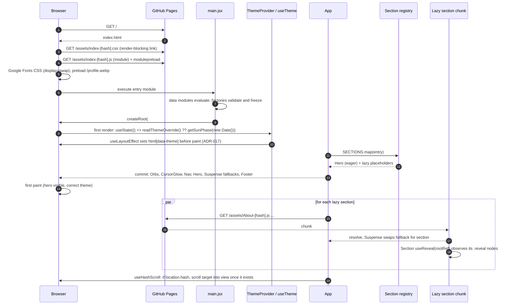

Notes:

- All lazy sections start loading immediately after the first commit, in parallel. Lazy loading here is code splitting to shrink the critical path. It is not on-scroll loading. This keeps anchor navigation and `Ctrl+F` working shortly after load.
- Step 18 (`useHashScroll`) exists because the browser's native scroll to `#contact` happens before the lazy content exists. It is part of `useActiveSection`'s module (ARC-009) and runs once when the target appears.

#### 4.4.2 Theme resolution: at load and on toggle

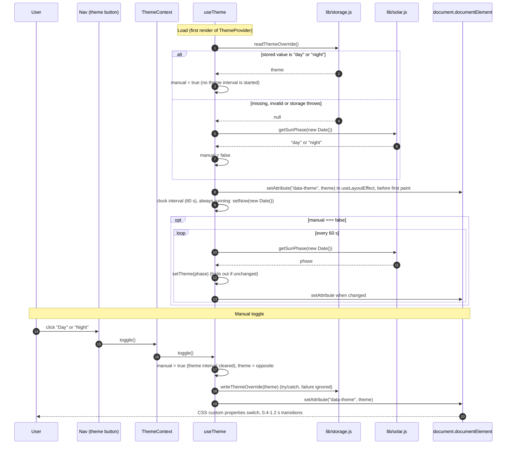

Behavioural contract (SRS v1.1 FR-THEME-001..008):

- The initial theme is a valid stored override if there is one (FR-THEME-008). Otherwise it is computed by `lib/solar.js` from the instant, using IST derived with UTC getters and the Chennai coordinates (FR-THEME-002, ADR-011).
- `data-theme` is written in a layout effect, so it is set before the browser paints the first commit of the app (FR-THEME-001, ADR-017).
- With no override, the phase is re-evaluated every 60 s. The theme interval is not started when an override exists at mount, and it is cleared once the user toggles (FR-THEME-003).
- A toggle writes `jsv-theme-override` = `day` or `night` through the guarded accessor. If storage is unavailable, the toggle still works for the page lifetime (ADR-018).
- The badge clock (`now`) has its own 60 s tick that runs whether or not an override is active (FR-THEME-005).
- `data-theme` is always explicitly `"day"` or `"night"`. CSS line 832 (`[data-theme="night"] .chip-icon-wrap img`) depends on the explicit `"night"` value.

The context value is `{ theme, isDay, toggle, now }`, memoised.

#### 4.4.3 Reveal-on-scroll observer flow

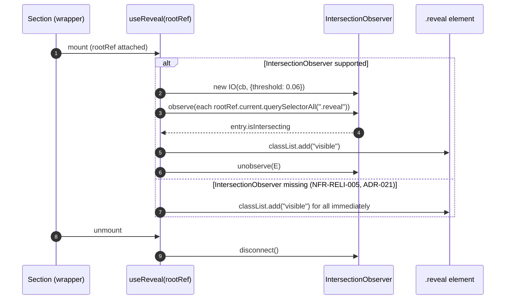

The effect depends only on `[rootRef]`, so it runs once per mount. Under React StrictMode the mount, cleanup, mount cycle in development creates the observer twice and disconnects the first. That is harmless because `.visible` is idempotent. The threshold and class names are identical to lines 967-976.

#### 4.4.4 Lazy section loading with Suspense and error containment

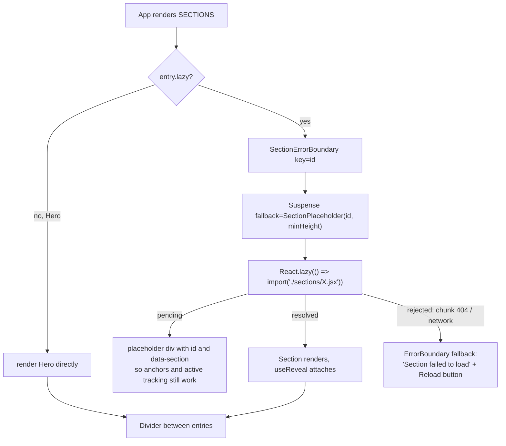

The placeholder carries the section `id` and `data-section`, and reserves a `min-height` from the registry entry. This limits layout shift (CLS) and keeps `href="#projects"` resolvable before the chunk arrives.

#### 4.4.5 Active-section tracking

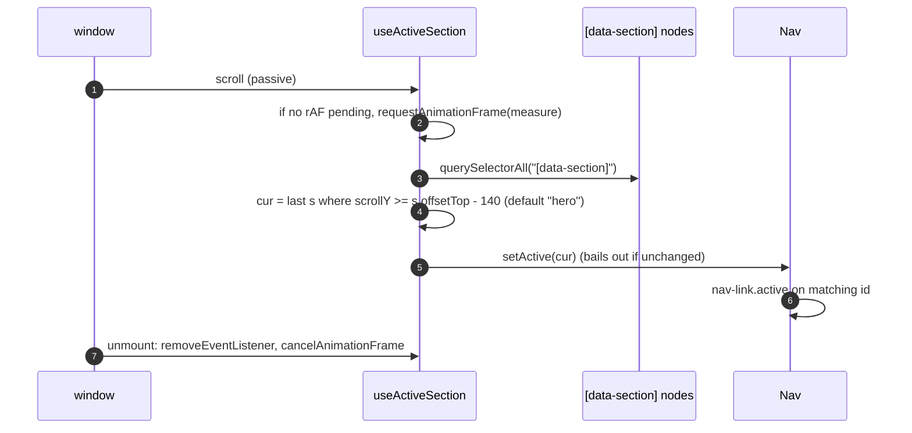

The offset (140 px), the default (`"hero"`) and the "last match wins" rule are identical to lines 978-992. The only change is coalescing reads to one per animation frame (P-17). `useScrolled` keeps `scrollY > 30` (line 997) for the `.nav.scrolled` class.

#### 4.4.6 Speedometer visibility gate (NFR-PERF-006)

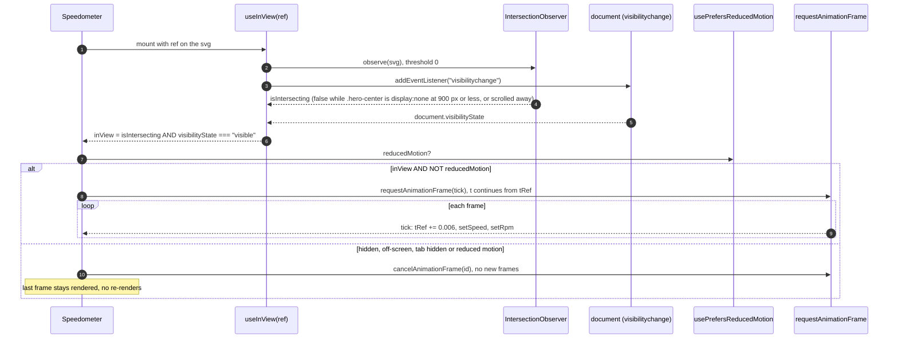

Rules:

- `t` lives in a ref (`tRef`), so the loop resumes from its current value when it becomes visible again (NFR-PERF-006).
- An element with `display: none` never intersects. One IntersectionObserver therefore covers both the "hidden at 900 px or less" case and the "scrolled out of view" case without reading media queries.
- If IntersectionObserver is missing, `useInView` reports `true`, so the gauge still animates (the baseline behaviour). Document visibility is still honoured.
- Under reduced motion, the static t = 0 frame from ADR-015 is rendered.

### 4.5 Deployment view

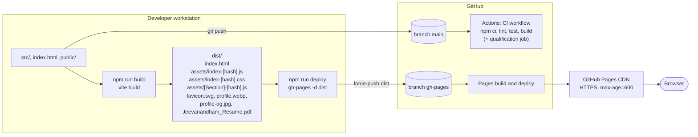

| Node | Artifact | Notes |
|---|---|---|
| Vite build | `dist/` | `base: '/'` (user site at the domain root). Hashed asset names allow long caching. Each `React.lazy` import becomes its own chunk. CSS is extracted to `assets/index-[hash].css`. |
| `gh-pages` branch | Contents of `dist/` | Published by the `gh-pages` package from the developer machine. Unchanged by this redesign (C-4). |
| GitHub Pages CDN | Static files | Custom headers are not possible, hence the CSP meta tag (ADR-013). `index.html` may be cached for up to 10 minutes after a deploy, which is the stale-chunk risk handled by ARC-015. |
| CI (`.github/workflows/ci.yml`) | No artifact published | Triggered on push to `main` and on PRs. Target steps: `npm ci` -> `npm run lint` -> `npm test` -> `npm run build`. A separate qualification job runs `npx playwright install --with-deps chromium` and `npm run test:qualification` against `vite preview` (ADR-016). |

---

## 5. Architecture elements catalogue (ARC)

Each element maps to a folder or file group in the brief. Unit-level detail (props and signatures per file) is in SUDS (`UNIT-*`).

### ARC-001 Application entry / bootstrap

- **Location:** `src/main.jsx`
- **Responsibilities:**
  - Import `styles/index.css` once.
  - Create the React root on `#root`.
  - Wrap `App` in `React.StrictMode` and a top-level `ErrorBoundary` (page-level fallback).
- **Provided interface:** none. This is the program entry referenced by `index.html` (`<script type="module" src="/src/main.jsx">`).
- **Required interface:** `react-dom/client.createRoot`, ARC-002, ARC-015, ARC-017.
- **Requirement areas:** FR-GEN-*, NFR-RELI-*.

### ARC-002 Composition root

- **Location:** `src/App.jsx`
- **Responsibilities:**
  - Compose `ThemeProvider` -> skip link (`<a class="skip-link" href="#main">Skip to content</a>`, first focusable element, ADR-020) -> `GradientOrbs`, `CursorGlow` -> `Nav` -> `<main id="main" tabIndex={-1}>` -> `<main>` (registry render with dividers, per-section `ErrorBoundary` + `Suspense`) -> `Footer`.
  - No content and no styles.
- **Provided interface:** `export default function App()`.
- **Required interface:** ARC-004 (`SECTIONS`), ARC-008, ARC-012, ARC-014, ARC-015.
- **Invariants:** DOM order equals registry order. A `Divider` sits between consecutive sections, which matches lines 2443-2459.
- **Requirement areas:** FR-GEN-*, FR-NAV-*.

### ARC-003 Site configuration

- **Location:** `src/config/site.js`
- **Responsibilities:** Frozen site-wide constants:
  - `OWNER_NAME`, `OWNER_TITLE`, `LOCATION`
  - `EMAIL`, `PHONE`, `PHONE_HREF`
  - `URLS` (`linkedin`, `behance`, `github`, `canonical`)
  - `RESUME` (`href: "Jeevanandham_Resume.pdf"`, `downloadName: "Jeevanandham_SeniorHMIEngineer_Resume.pdf"`, `pages: 3`). All three download links (Hero CTA, Resume button, Resume preview link) use `downloadName` (P-25, FR-HERO-007, FR-RES-003).
  - `THEME_STORAGE_KEY = "jsv-theme-override"` (FR-THEME-008)
  - `FOOTER_TEXT`
  - `THEME_GEO` (`lat 13.08`, `lon 80.27`, `tzOffsetHours 5.5`)
- **Provided interface:** named ES exports, all `Object.freeze`d.
- **Required interface:** none.
- **Requirement areas:** FR-CONT-*, FR-RES-*, FR-GEN-*, NFR-MAINT-*.

### ARC-004 Section registry

- **Location:** `src/config/sections.js`
- **Responsibilities:** The single source of truth for section order, nav membership, labels, icons and loading strategy.
- **Provided interface:**

  ```js
  /** @type {ReadonlyArray<SectionEntry>} */
  export const SECTIONS; // [{ id, label, icon, number, component, lazy, showInNav, minHeight }]
  export const NAV_ITEMS; // SECTIONS.filter(s => s.showInNav)
  ```

  - `hero` is `{lazy:false, showInNav:false}`.
  - The 9 others are `lazy:true, showInNav:true`, in the order about, experience, skills, projects, design, education, certifications, resume, contact.
  - The nav label "Certs" differs from the section heading "07 — Certifications", so `label` (nav) and `heading` (section label text) are separate fields.
  - `number` is derived from position ("01".."09"), so headings are no longer hard-coded.
- **Required interface:** `React.lazy`, ARC-016.
- **Requirement areas:** FR-NAV-*, NFR-MAINT-*, NFR-PERF-*.

### ARC-005 Domain models

- **Location:** `src/models/{index.js, types.js, createModels.js, validate.js}`
- **Responsibilities:**
  - JSDoc `@typedef` for every entity in section 7.
  - Factory functions `createProfile`, `createStat`, `createSection`, `createExperience`, `createSkill`, `createSkillCategory`, `createProject`, `createDesignCard`, `createEducation`, `createCertification`, `createContactLink`, `createResumeSkill`, `createHighlight`. Each factory validates and then deep-freezes.
  - `validate.js` provides `assertString`, `assertNonEmptyString`, `assertArray`, `assertBoolean`, `assertColor` (hex, `rgba()` or `linear-gradient(...)`), `assertUrl`, `assertEmail`, `assertIconRef` (`/^(si|ms|svg):[a-z0-9_]+$/`) and `assertOneOf`. Each throws `ModelValidationError(model, field, message)`.
- **Provided interface:** `create*` functions returning frozen objects. `ModelValidationError`.
- **Required interface:** none. No React.
- **Requirement areas:** NFR-MAINT-*, NFR-RELI-*.

### ARC-006 Content data

- **Location:** `src/data/{profile, experience, skills, projects, design, education, certifications, contact}.js`. `navigation.js` is not needed because ARC-004 covers navigation.
- **Responsibilities:** Hold all user-visible content as model instances, with text byte-identical to the monolith.
  - `profile.js`: `PROFILE`, `STATS` (4), `HERO_ROLES` (5), `HERO_BADGES` (8), `GAUGE_STATS` (3), `GAUGE_STACK_TAGS` (5), `PROFILE_TAGS` (4), `ABOUT_PARAGRAPHS`, `RESUME_PREVIEW` (rows + 4 skill bars)
  - `experience.js`: `EXPERIENCE` (4)
  - `skills.js`: `SKILL_CATEGORIES` (9 categories, 58 skills), `SAFETY_HIGHLIGHT` (ISO 26262 strip)
  - `projects.js`: `PROJECTS` (6)
  - `design.js`: `DESIGN_CARDS` (5, with `artKey` in place of JSX)
  - `education.js`: `EDUCATION` (2)
  - `certifications.js`: `CERTIFICATIONS` (3)
  - `contact.js`: `CONTACT_LINKS` (5, grouped in 2 rows), `CONTACT_INTRO`
- **Provided interface:** frozen arrays and objects.
- **Required interface:** ARC-005, ARC-003.
- **Requirement areas:** FR-HERO, ABOUT, EXP, SKILL, PROJ, DESIGN, EDU, CERT, RES and CONT, all `-*`.

### ARC-007 Pure libraries

- **Location:** `src/lib/solar.js`, `src/lib/random.js`, `src/lib/storage.js` (**new in v1.1**)
- **Responsibilities:**
  - `solar.js`: `getSunPhase(date, geo = THEME_GEO_DEFAULT) -> "day" | "night"`, plus the helpers `toIst(date)`, `dayOfYear(date)`, `sunriseSunsetHours(dayOfYear, latDeg)` and the constant `LONGITUDE_CORRECTION_H` (= 5.5 − 80.27/15 ≈ +0.14867 h). The algorithm follows SRS v1.1 FR-THEME-002: steps 3-5 and 7 are unchanged from lines 925-944, and steps 1, 2 and 6 are corrected (ADR-011).
  - `storage.js`: `readThemeOverride(storage = globalThis.localStorage) -> "day" | "night" | null` and `writeThemeOverride(theme, storage = globalThis.localStorage) -> boolean`. Every access is wrapped in try/catch. Invalid values read as `null`. Only the key `jsv-theme-override` is ever touched (FR-THEME-008, ADR-018). The storage parameter makes it testable with a stub. This module performs I/O, so it is the one module in `lib/` that is not strictly pure, but it holds no state and imports nothing.
  - `random.js`: `mulberry32(seed) -> () => number in [0, 1)` and `createParticles(count, rng) -> Particle[]`. The particle field formulas are identical to lines 1709-1719, with `Math.random` replaced by `rng`.
- **Provided interface:** functions only, with no module state. `solar.js` and `random.js` are pure. `storage.js` is a guarded I/O adapter.
- **Required interface:** none (`storage.js` takes `localStorage` as an injectable default parameter).
- **Requirement areas:** FR-THEME-002, FR-THEME-008, FR-FX-003, NFR-MAINT-*.

### ARC-008 Theme context

- **Location:** `src/context/ThemeContext.jsx`
- **Responsibilities:** Provider pattern. `ThemeProvider` calls `useTheme()` once and exposes `{ theme, isDay, toggle, now }`. `useThemeContext()` throws a descriptive error when used outside the provider.
- **Provided interface:** `ThemeProvider({children})`, `useThemeContext()`.
- **Required interface:** ARC-009 (`useTheme`).
- **Requirement areas:** FR-THEME-*.

### ARC-009 Custom hooks

- **Location:** `src/hooks/*.js`
- **Responsibilities:** Encapsulate every side effect.

| Hook | Contract | Origin (lines) |
|---|---|---|
| `useTheme()` | `-> {theme, isDay, toggle, now}`. Initial state: `readThemeOverride()` or else `getSunPhase(new Date())`. Sets `data-theme` in a layout effect (ADR-017). Theme interval (60 s) only without an override. Clock interval (60 s) always. `toggle` writes the override (ADR-018). | 924-965 |
| `useReveal(rootRef)` | Observer pattern. Threshold 0.06. Adds `visible` and unobserves. Without IntersectionObserver it adds `visible` to every `.reveal` under the root immediately and throws nothing (NFR-RELI-005, ADR-021). | 967-976 |
| `useActiveSection(defaultId = "hero")` | `-> activeId`. rAF-coalesced scroll handler with a 140 px offset. Also handles the one-shot hash scroll after lazy content appears. | 978-992 |
| `useScrolled(threshold = 30)` | `-> boolean` | 994-1002 |
| `useTypewriter(words, {speed=65, deleteSpeed=35, pause=1800, jitter=30, rng=Math.random, enabled=true})` | `-> string`. With `enabled=false` it returns `words[0]`. | 1004-1036 |
| `useParallax({enabled=true})` | `-> ref`. Applies `perspective(900px) rotateY(x) rotateX(-y) translateZ(8px)` with ±7°. | 1038-1051 |
| `usePrefersReducedMotion()` | `-> boolean` via `matchMedia("(prefers-reduced-motion: reduce)")` with a change listener. Returns `false` without `matchMedia`. | new |
| `useInView(ref, {trackDocumentVisibility = true})` (**new in v1.1**) | `-> boolean`: `true` while the element intersects the viewport (IntersectionObserver, threshold 0) and, when tracking is on, `document.visibilityState === "visible"`. Returns `true` when IntersectionObserver is missing. Disconnects and removes the listener on unmount (NFR-PERF-006, ADR-019). | new |

- **Required interface:** React, ARC-007 (`solar`, `storage`).
- **Requirement areas:** FR-THEME, FR-NAV and FR-FX, all `-*`; NFR-A11Y-*, NFR-PERF-006, NFR-RELI-005.

### ARC-010 UI primitives

- **Location:** `src/components/ui/{Icon, SectionLabel, SectionTitle, Button, Badge, Section}.jsx`
- **Responsibilities:** Content-agnostic presentational components.
  - `Icon` (was `Ms`): the same inline style object as line 1057, with `aria-hidden="true"` by default (NFR-A11Y-007) and an optional `label` that switches to `role="img"` + `aria-label`. It does not emit the `ms` class (P-08, F-17).
  - `SectionLabel` (was `SL`): `<div class="section-label">` + Icon(13) + text.
  - `SectionTitle` (was `ST`): `<h2 class="section-title">`.
  - `Button`: `<a class="btn btn-{variant}">` with `variant ∈ amber | outline | green`, plus `icon`, `href`, `download`, `external`. `external` adds `target="_blank" rel="noopener noreferrer"`.
  - `Badge`: `<span class="badge">`.
  - `Section`: `{as="section", id, className, style, label:{icon,text}, title, children}`. It renders `id`, `data-section`, `SectionLabel` and `SectionTitle`, and calls `useReveal(ref)`.
- **Required interface:** React, ARC-009 (`useReveal`).
- **Must not import:** data or config.
- **Requirement areas:** NFR-A11Y-*, NFR-MAINT-*.

### ARC-011 Tech icon subsystem

- **Location:** `src/components/tech/{TechIcon.jsx, iconStrategies.js, customSvgs.jsx, SkillChip.jsx}`
- **Responsibilities:**
  - `TechIcon` parses an `IconRef` (`"si:slug" | "ms:name" | "svg:key"`) and delegates to a strategy (section 6.8).
  - `customSvgs.jsx` is the `CUSTOM_SVGS` registry: 30 keys, each `(color, size) => <svg>`, moved verbatim from lines 1126-1434.
  - `iconStrategies.js` maps prefix -> strategy. The fallback strategy renders `Icon("code")`.
  - `SkillChip` renders `.skill-chip` with the same hover-driven inline styles as lines 1466-1486.
- **Provided interface:** `TechIcon({icon, color, size=22})`, `SkillChip({skill, catColor})`, `CUSTOM_SVGS`, `ICON_STRATEGIES`, `parseIconRef(ref)`.
- **Required interface:** React, ARC-010.
- **Requirement areas:** FR-SKILL-*, NFR-RELI-*.

### ARC-012 Visual effects

- **Location:** `src/components/effects/{GradientOrbs, CursorGlow, Particles}.jsx`
- **Responsibilities:** Decorative, `aria-hidden` background effects.
  - `GradientOrbs`: 4 orbs, pure CSS.
  - `CursorGlow`: follows the pointer. Position updates are coalesced via rAF. It is not mounted when reduced motion is set, and CSS already hides it then (line 915).
  - `Particles`: 18 particles from `createParticles(18, mulberry32(SEED))`, computed once at module scope.
- **Required interface:** React, ARC-007, ARC-009.
- **Requirement areas:** FR-FX-*, NFR-A11Y-*, NFR-PERF-*.

### ARC-013 Widgets

- **Location:** `src/components/widgets/Speedometer.jsx`
- **Responsibilities:** Animated SVG gauge (speed 0-180, RPM 0-8000), geometry identical to lines 1739-1816.
  - The pure geometry helpers (`arcPath`, `angleFor`, `ticks`) are module-level functions that can be exported for unit tests.
  - The rAF loop runs only while `useInView(svgRef)` is `true` and reduced motion is not preferred. It schedules no frame and triggers no re-render otherwise, and resumes from `tRef` when visible again (NFR-PERF-006, ADR-019, section 4.4.6). Under reduced motion it renders the frame at t=0 (ADR-015).
  - SVG `id`s (`gbg`, `arcGrad`, `rpmGrad`, `needleGrad`, `glow`, `softGlow`) are kept for parity. Only one instance exists.
- **Required interface:** React, ARC-009 (`useInView`, `usePrefersReducedMotion`).
- **Requirement areas:** FR-HERO-*, FR-FX-*, NFR-PERF-006, NFR-A11Y-002.

### ARC-014 Layout

- **Location:** `src/components/layout/{Nav, Footer, Divider}.jsx`
- **Responsibilities:**
  - `Nav` renders the logo, the desktop links from `NAV_ITEMS`, the theme badge (`DAY`/`NIGHT` · time, `en-IN`, 12 h) and the theme toggle from `useThemeContext`, the hamburger with `aria-expanded`/`aria-controls="mobile-menu"` (FR-NAV-011), and the mobile menu, which closes on link click. While the menu is open, Escape closes it and returns focus to the hamburger (FR-NAV-012). The badge time comes from the context `now` and refreshes at least every 60 s (FR-THEME-005).
  - `Footer` renders the icon + `FOOTER_TEXT` + icon.
  - `Divider` renders `<div class="divider">`.
- **Required interface:** ARC-004, ARC-003, ARC-008, ARC-009, ARC-010.
- **Requirement areas:** FR-NAV-*, FR-THEME-*, NFR-A11Y-*, NFR-USAB-*.

### ARC-015 Error boundary

- **Location:** `src/components/ErrorBoundary.jsx`
- **Responsibilities:** A class component that implements `getDerivedStateFromError` and `componentDidCatch`, the latter logging through `console.error`. It is used at two levels:
  1. **Page level**, in `main.jsx`: a minimal fallback with the owner's name, a reload button and a link to the resume PDF.
  2. **Section level**, in `App`, keyed by section id: a compact in-flow fallback with a "Reload" action. This catches render errors and lazy-chunk load failures.
- **Provided interface:** `ErrorBoundary({fallback?: ReactNode | (error, reset) => ReactNode, onError?, children})`.
- **Required interface:** React, ARC-010.
- **Requirement areas:** NFR-RELI-*.

### ARC-016 Sections (containers)

- **Location:** `src/sections/{Hero, About, Experience, Skills, Projects, Design, Education, Certifications, Resume, Contact}.jsx`
- **Responsibilities:** One container per page section. Each reads its data module(s) and composes presentational components. The emitted markup (elements, class names, inline styles, text) is identical to the monolith functions at lines 1881-2426.
  - The design-card art registry (`DESIGN_ART`, keyed by `artKey`) is module-private to `Design.jsx`. It may be extracted to `components/widgets/DesignArt.jsx` if it grows.
  - The "Key Domain Expertise" inline-styled tags in `Education` are kept verbatim.
- **Provided interface:** one default-exported component per file, with no props. Identity comes from ARC-004.
- **Required interface:** ARC-006, ARC-003, ARC-009, ARC-010, ARC-011, ARC-012, ARC-013, ARC-008.
- **Requirement areas:** FR-HERO, ABOUT, EXP, SKILL, PROJ, DESIGN, EDU, CERT, RES and CONT, all `-*`.

### ARC-017 Styles

- **Location:** `src/styles/{tokens, base, components, sections, index}.css`
- **Responsibilities:** The monolith CSS (lines 6-917) split by concern, with **every rule and value unchanged and the relative cascade order preserved** (section 8.1). v1.1 adds exactly two new rule groups, appended so they cannot change existing cascade outcomes: `.skip-link` (+ `:focus`) in `components.css`, and the `:focus-visible` / `:focus:not(:focus-visible)` rules in `base.css` (ADR-020). The CSS-equivalence test allow-lists these selectors.
- **Provided interface:** global class names and the custom properties `--bg … --glass-shine`, `--dx`, `--dur`, `--delay`, `--sg-color`.
- **Required interface:** none. It is imported by ARC-001.
- **Requirement areas:** FR-THEME-*, NFR-A11Y-*, NFR-PORT-*.

### ARC-018 HTML shell and static assets

- **Location:** `index.html`, `public/`
- **Responsibilities:**
  - SEO and social metadata, the font preconnect and stylesheet, the hero image preload, `<noscript>` and `#root`.
  - Static assets served verbatim: `favicon.svg`, `profile.webp`, `profile-og.jpg` and `Jeevanandham_Resume.pdf` (about 4.0 MB).
  - The CSP `<meta http-equiv>` (ADR-013) is added here.
- **Requirement areas:** NFR-SEO-*, NFR-SEC-*, FR-RES-*.

### ARC-019 Test suite

- **Location:** `tests/unit/**`, `tests/integration/**`, `tests/qualification/**`, `tests/setup.js`, `vitest.config.js` (or a `test` block in `vite.config.js`), `playwright.config.js`
- **Responsibilities:** The three ASPICE-aligned test levels (section 8.8).
- **Requirement areas:** all, through STP traceability.

### ARC-020 Build, quality gate and delivery pipeline

- **Location:** `vite.config.js`, `eslint.config.js`, `package.json` scripts, `.github/workflows/ci.yml`
- **Responsibilities:**
  - Build (Vite 7, Rollup chunking).
  - Static analysis (ESLint 9 with hooks and refresh rules, plus the import-boundary rules from section 4.3.2).
  - Scripts: `dev`, `build`, `preview`, `lint`, `test`, `test:coverage`, `test:qualification`, `deploy`.
  - CI gate: lint, test, build and qualification.
  - Manual deploy to `gh-pages`.
- **Requirement areas:** NFR-DEPLOY-*, NFR-MAINT-*.

### 5.1 Element-to-requirement-area summary

| ARC | NAV | HERO | ABOUT | EXP | SKILL | PROJ | DESIGN | EDU | CERT | RES | CONT | THEME | FX | GEN | Main NFR cats |
|---|---|---|---|---|---|---|---|---|---|---|---|---|---|---|---|
| 001 |  |  |  |  |  |  |  |  |  |  |  |  |  | x | RELI |
| 002 | x |  |  |  |  |  |  |  |  |  |  |  |  | x | PERF, RELI |
| 003 |  | x |  |  |  |  |  |  |  | x | x |  |  | x | MAINT |
| 004 | x |  |  |  |  |  |  |  |  |  |  |  |  | x | MAINT, PERF |
| 005 |  |  |  |  |  |  |  |  |  |  |  |  |  |  | MAINT, RELI |
| 006 |  | x | x | x | x | x | x | x | x | x | x |  |  |  | MAINT |
| 007 |  |  |  |  |  |  |  |  |  |  |  | x | x |  | MAINT |
| 008 |  |  |  |  |  |  |  |  |  |  |  | x |  |  | USAB |
| 009 | x | x |  |  |  |  |  |  |  |  |  | x | x |  | A11Y, PERF |
| 010 |  |  |  |  |  |  |  |  |  |  |  |  |  | x | A11Y |
| 011 |  |  |  |  | x |  |  |  |  |  |  |  |  |  | RELI, SEC |
| 012 |  |  |  |  |  |  |  |  |  |  |  |  | x |  | A11Y, PERF |
| 013 |  | x |  |  |  |  |  |  |  |  |  |  | x |  | PERF, A11Y |
| 014 | x |  |  |  |  |  |  |  |  |  |  | x |  |  | A11Y, USAB |
| 015 |  |  |  |  |  |  |  |  |  |  |  |  |  | x | RELI |
| 016 |  | x | x | x | x | x | x | x | x | x | x |  |  |  | A11Y |
| 017 |  |  |  |  |  |  |  |  |  |  |  | x | x |  | PORT, A11Y |
| 018 |  |  |  |  |  |  |  |  |  | x |  |  |  | x | SEO, SEC |
| 019 | all |  |  |  |  |  |  |  |  |  |  |  |  |  | all |
| 020 |  |  |  |  |  |  |  |  |  |  |  |  |  |  | DEPLOY, MAINT |

---

## 6. Design patterns applied

### 6.1 Layered architecture

- **Problem:** The monolith mixes content, styling, state and markup (P-01). A change to one concern risks the others, and nothing can be tested alone.
- **Where:** The whole of `src/` (section 4.2).
- **Participants:**
  - L1: `models`, `lib`, `config`, `data`
  - L2: `hooks`, `context`
  - L3: `components`, `sections`
  - L4: `App`, `main`
- **Consequences:**
  - (+) Each layer can be tested at its own level. L1 needs plain Node and Vitest. L2 needs `renderHook`. L3 needs RTL.
  - (+) Content edits touch L1 only.
  - (−) More files and more indirection. The cost is mitigated by the dependency rules being lint-enforced.

### 6.2 Factory with validation (domain models)

- **Problem:** Content objects are untyped literals. A typo (`desc` vs `description`, a missing `color`) renders silently wrong.
- **Where:** `models/createModels.js`, used by every `data/*.js`.
- **Participants:** factory functions `create<Model>(raw)`, `validate.js` assertions, `ModelValidationError`, and data modules as clients.
- **Consequences:**
  - (+) Bad content fails at module evaluation with a precise message, so tests catch it in CI (ADR-010).
  - (+) Factories may normalise. Example: `createDesignCard` defaults `href` to `URLS.behance`.
  - (−) Validation costs a little time at load: about 100 objects, which is negligible.
  - (−) Factories must be kept in sync with the JSDoc typedefs.

### 6.3 Immutable value objects

- **Problem:** Shared module-level arrays could be mutated by a component, for example by sorting in place, and corrupt other renders.
- **Where:** Every factory return value and every `config` export (`Object.freeze`, applied recursively to nested arrays and objects).
- **Participants:** `deepFreeze(obj)` in `validate.js`, and all model instances.
- **Consequences:**
  - (+) Safe to share across components and to use as stable references, for example the `useTypewriter(words)` dependency.
  - (+) Mutation attempts throw in strict mode (ES modules), which surfaces bugs.
  - (−) Consumers must copy before deriving, for example with `[...arr].sort()`.

### 6.4 Registry (sections, custom SVGs, design art, icon strategies)

- **Problem:** Lists of variants were encoded in several places: nav, page order, headings (P-16). Data embedded JSX (P-13).
- **Where:**
  - `config/sections.js` (`SECTIONS`, `NAV_ITEMS`)
  - `components/tech/customSvgs.jsx` (`CUSTOM_SVGS`)
  - `sections/Design.jsx` (`DESIGN_ART`)
  - `components/tech/iconStrategies.js`
- **Participants:** the registry (a frozen map or array), keys stored in data (`id`, `svg:<key>`, `artKey`), and resolvers (`App`, `Nav`, `TechIcon`, `Design`).
- **Consequences:**
  - (+) Open/closed: a new section, icon or artwork is one entry.
  - (+) Data stays serialisable and React-free.
  - (−) Unknown keys must be handled. The fallback is `Icon("code")` for icons, a validator error at test time for `artKey`, and a dev-time assertion for registry ids.

### 6.5 Provider / Context

- **Problem:** The theme is needed by `Nav` (badge and toggle) and potentially by any component. The monolith prop-drills `theme` and `onToggle` into `Nav` (line 2440).
- **Where:** `context/ThemeContext.jsx`. `ThemeProvider` wraps the tree in `App`.
- **Participants:** `ThemeProvider` (owner of `useTheme` state), `useThemeContext` (consumer hook), consumers (`Nav`, `Footer` optionally).
- **Consequences:**
  - (+) No prop drilling. There is a single owner of the theme state.
  - (+) A test can wrap components in a provider with a fixed theme.
  - (−) Every consumer re-renders on context change. That is acceptable because the value changes at most once per minute or on a click. The value object is memoised.

### 6.6 Custom Hook

- **Problem:** Side effects (listeners, timers, observers, `document` writes) are scattered and hard to test.
- **Where:** `hooks/*` (ARC-009).
- **Participants:** hook functions, components as callers, `@testing-library/react`'s `renderHook` in tests.
- **Consequences:**
  - (+) Each effect has one owner, an explicit cleanup and a testable contract.
  - (+) Options parameters such as `enabled` and `rng` allow deterministic tests.
  - (−) Hook rules apply. The `react-hooks` lint plugin enforces them.

### 6.7 Observer

- **Problem:** Reveal animations, the speedometer pause and active-section tracking all need to react to viewport and scroll changes without polling.
- **Where:**
  - `useReveal` (IntersectionObserver)
  - `Speedometer` visibility (IntersectionObserver + `visibilitychange`)
  - `usePrefersReducedMotion` (MediaQueryList `change`)
  - `useActiveSection` and `useScrolled` (`scroll` events)
- **Participants:** subject (browser API), observer callback, subscription and unsubscription in effect setup and cleanup.
- **Consequences:**
  - (+) Event-driven and off the main thread where the browser supports it.
  - (−) jsdom lacks IntersectionObserver and matchMedia, so tests stub them in `tests/setup.js`. Production code feature-detects them.

### 6.8 Strategy (TechIcon)

- **Problem:** Three icon sources (Simple Icons CDN, Material Symbols, custom SVG) were handled by an if-chain inside `TechIcon` (lines 1440-1462). Adding a source meant editing the component.
- **Where:** `components/tech/iconStrategies.js` and `TechIcon.jsx`.
- **Participants:**
  - Context: `TechIcon`.
  - Strategy interface: `({ value, color, size, onError, failed }) => ReactNode`.
  - Concrete strategies: `si` (an `` with error fallback), `ms` (`Icon`), `svg` (`CUSTOM_SVGS[value]` lookup).
  - Fallback strategy: `Icon("code")`.
  - `parseIconRef("si:qt") -> {kind:"si", value:"qt"}`.
- **Consequences:**
  - (+) New icon sources mean a new strategy entry, and each strategy is unit-testable.
  - (−) `si` needs per-instance error state, so `TechIcon` keeps `useState(false)` and passes it to the strategy.

### 6.9 Container / Presentational

- **Problem:** Sections mixed data definitions with markup. Primitives were tied to no particular data but lived next to it.
- **Where:**
  - Containers: `sections/*`, which know which data module to read.
  - Presentational: `components/ui`, `components/tech`, `components/widgets`, `components/layout`, which receive everything through props or context.
- **Participants:** container -> data module (import) -> presentational (props).
- **Consequences:**
  - (+) Presentational components are reusable and snapshot-testable with fixture props.
  - (+) The `ui must not import data` rule is enforceable.
  - (−) Some thin pass-through code.

### 6.10 Error Boundary

- **Problem:** Any render error, or a failed lazy chunk, blanks the entire SPA (P-18).
- **Where:** `components/ErrorBoundary.jsx`, page level in `main.jsx` and section level in `App`.
- **Participants:** the boundary (a class component with `getDerivedStateFromError` and `componentDidCatch`), fallback UI, and children.
- **Consequences:**
  - (+) Failures are contained to a section. The fallback offers a reload, which also recovers from stale chunk hashes after a redeploy.
  - (−) Boundaries do not catch errors in event handlers, timers or module evaluation of eagerly imported modules. Those are covered by tests (ADR-010) and defensive hooks.

### 6.11 Lazy loading / code splitting

- **Problem:** The single 304 kB chunk (84.8 kB gzip) delays interactivity, although most content is below the fold.
- **Where:** `config/sections.js` (`React.lazy(() => import("../sections/X.jsx"))`) and `App` (a `Suspense` per section).
- **Participants:** `React.lazy`, `Suspense`, `SectionPlaceholder`, Rollup dynamic-import chunks.
- **Consequences:**
  - (+) A smaller initial chunk. The tech icon system (about 310 lines of SVG) and the design art travel only with their sections.
  - (+) Chunks are cacheable independently.
  - (−) More requests (HTTP/2 mitigates this).
  - (−) Possible layout shift, mitigated by `minHeight`.
  - (−) Hash deep links need `useHashScroll`. Reveal must be per-section (ADR-012).

### 6.12 Pure-function core

- **Problem:** Logic embedded in hooks and components (solar maths, particle generation, gauge geometry, active-section selection) cannot be tested without rendering, timers and DOM.
- **Where:**
  - `lib/solar.js`, `lib/random.js`
  - the geometry helpers in `Speedometer.jsx`
  - `pickActiveSection(sections, scrollY, offset)` exported from `useActiveSection.js`
  - `parseIconRef`
- **Participants:** pure functions (input -> output, no I/O), and thin hook or component shells that call them.
- **Consequences:**
  - (+) Exhaustive unit tests are cheap. Coverage targets of at least 90 % for lib, models and hooks are realistic.
  - (+) Determinism: seeded RNG and injected `Date`.
  - (−) A small amount of parameter plumbing.

---

## 7. Domain model

All fields below come from the monolith's data and markup. The types are JSDoc types in `models/types.js`. `IconName` is a Material Symbols ligature. `IconRef` is `"si:<slug>" | "ms:<name>" | "svg:<key>"`. `CssColor` is a hex value, `rgba(...)` or `linear-gradient(...)`.

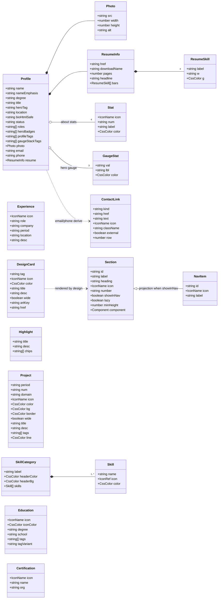

Cardinalities and invariants (checked by factories and tests):

| Model | Instances | Invariants |
|---|---|---|
| Section | 10 (hero + 9) | `id` unique, matches `/^[a-z]+$/`. Exactly one non-lazy entry (`hero`), and it is first. `NAV_ITEMS` order equals the original `NAV` (lines 1074-1084). |
| Stat | 4 | `num` non-empty. `color` hex. |
| Experience | 4 | All fields are non-empty strings. `period` matches `MON YYYY — MON YYYY`. |
| SkillCategory / Skill | 9 / 58 | `skills.length ≥ 1`. `Skill.icon` is a valid `IconRef`. Every `svg:` key exists in `CUSTOM_SVGS` (integration test). Skill names are unique within a category (they are React keys, line 2072). |
| Project | 6 | `num` unique (React key, line 2114). `tags.length ≥ 1`. |
| DesignCard | 5 | `title` unique (React key, line 2267). `artKey ∈ DESIGN_ART`. `href` is a valid https URL. |
| Education | 2 | `tags.length ≥ 1`. |
| Certification | 3 | `name` unique (React key, line 2330). |
| ContactLink | 5 | `kind` unique. `external` ⇔ `href` starts with `https:`. `email` matches the `mailto:` href. |

---

## 8. Cross-cutting concerns

### 8.1 Styling architecture

**Split.** The `CSS` string (lines 6-917) is moved, not rewritten, into four files. They are imported in a fixed order by `styles/index.css`:

| File | Source lines (monolith) | Content |
|---|---|---|
| `tokens.css` | 8-51 | `:root` (night tokens) and `[data-theme="day"]` overrides |
| `base.css` | 53-132, 520-540, 883-916 | Theme transitions, reset, `html`/`body`, selection, scrollbar, grid background (`body::before/::after`), all `@keyframes`, `.section-wrap`, `.full-band`, `.divider`, `.section-label`, `.section-title`, `.reveal` / `.d1-.d3`, responsive media queries, reduced-motion |
| `components.css` | 134-302, 410-457, 776-781, 799-843, 314-380 | Orbs, cursor glow, glass, theme button and badge, nav, mobile menu, badge, buttons, particles, skill chips, gauge widget, hero rings |
| `sections.css` | 304-313, 382-409, 423, 459-519, 542-775, 783-797, 845-881 | Hero, profile card, about, experience, skills, projects, design, certs, education, resume, contact, footer, ISO strip |

**Cascade-order rule.** Splitting changes source order. Equal-specificity rules can only change outcome if two rules that target the same element and property move relative to each other. The following ordering constraints must hold:

1. Within each file, rules keep their monolith order.
2. The media queries at lines 883-916 and the reduced-motion block come **last** overall. They are placed at the end of `sections.css` (or in a fifth import position) rather than in `base.css`, because they override `.hero`, `.nav-links`, `.btn` and so on, and several rely on source order as well as `!important`.
3. The theme-transition block (lines 53-65) must stay **before** the component rules whose own `transition` should win. For example, `.btn { transition: all 0.25s }` (line 429) currently overrides the generic block for `.btn`, and `.nav { transition: all 0.3s }` (line 277) overrides it for `.nav`.

A CSS-equivalence test (section 10, step 2) enforces this. It concatenates `styles/*.css` in import order and compares the normalised rule list against a fixture extracted from the baseline `CSS` string.

**Theming.**
- The theme is a single attribute, `data-theme="day" | "night"`, on `<html>`, owned by `useTheme` (ARC-009).
- All colours that vary by theme are CSS custom properties defined in `tokens.css`. Components reference `var(--…)`.
- Theme-specific overrides use `[data-theme="day"] .selector`. One rule, `[data-theme="night"] .chip-icon-wrap img` at line 832, depends on the explicit night value.
- No JS reads computed colours. The few hard-coded hex values in inline styles and in the speedometer SVG are theme-independent today and stay so for parity.

**Inline styles.** These are kept where the monolith has them and are data-driven: per-item colours, gradients, the particle `--dur/--delay/--dx` and hover states. Moving them to classes is out of scope because it carries parity risk.

**Fonts.** These are loaded by `index.html` from Google Fonts with `display=swap`. Token variables are `--mono`, `--sans` and `--disp`.

### 8.2 State management

| State | Owner | Scope | Persistence |
|---|---|---|---|
| Theme (`day`/`night`), manual flag, `now` | `useTheme` via `ThemeProvider` | Global (context) | Only the manual choice, in `localStorage` key `jsv-theme-override` (`day` or `night`), via `lib/storage.js` (FR-THEME-008, ADR-018). The automatic theme and the clock are not stored. |
| Active section id | `useActiveSection` in `Nav` | Nav | None |
| Nav scrolled flag | `useScrolled` in `Nav` | Nav | None |
| Mobile menu open | `useState` in `Nav` (Escape closes it, FR-NAV-012) | Nav | None |
| Typewriter text and index | `useTypewriter` in `Hero` (ref + state) | Hero | None |
| Speedometer speed and RPM, `tRef`, in-view flag | `Speedometer` local state + `useInView` | Widget | None |
| Cursor position | `CursorGlow` local state | Effect | None |
| Icon load failure | `TechIcon` local state | Per icon | None |
| Chip hover | `SkillChip` local state | Per chip | None |
| Card hover (About stats, Projects, Resume links) | DOM style mutation in handlers | Per element | None. This is parity (P-15). |
| Reveal visibility | DOM class `visible` via `useReveal` | Per element | None |

There is no global store. React state plus one context is sufficient. Adding a state library would violate C-2.

### 8.3 Error handling

| Failure | Detection | Handling |
|---|---|---|
| Invalid content | Factory `ModelValidationError` at module evaluation | CI fails (unit and integration tests import every data module). Never shipped (ADR-010). |
| Render error in a section | Section-level `ErrorBoundary` | Compact fallback in place of the section. Other sections are unaffected. Logged via `console.error`. |
| Lazy chunk load failure | `React.lazy` promise rejection, surfaced to the boundary | Fallback with a "Reload page" button (`location.reload()`) |
| Render error in App, Nav or Hero | Page-level `ErrorBoundary` (`main.jsx`) | Minimal static page with name, title, email and resume link |
| Simple Icons image error | `` | `Icon("code")` fallback (parity, line 1453) |
| `localStorage` unavailable, throwing (private mode, blocked site data, quota) or holding an invalid value | try/catch and value check in `lib/storage.js` | Read returns `null`, so the automatic theme applies. A failed write is ignored and the toggle still works for the page lifetime. No console error (FR-THEME-008). |
| IntersectionObserver missing | Feature check in `useReveal` and `useInView` | Reveal: all `.reveal` content is made visible immediately (NFR-RELI-005). Gauge: treated as in view, with document visibility still honoured. |
| Profile photo error | `` | Hide the image (parity, line 1960). The gradient frame remains. |
| Missing browser APIs (matchMedia, rAF) | Feature detection in hooks | Degrade: content visible, no motion |
| `useThemeContext` used outside the provider | Hook guard | Throws `Error("useThemeContext must be used within ThemeProvider")`. This is a developer error caught in tests. |

### 8.4 Accessibility (target WCAG 2.1 AA, NFR-A11Y-*)

- **Landmarks:** `<nav aria-label="Primary">`, `<main>` and `<footer>` are kept. Sections keep their element type for parity. Switching the 4 `div` sections to `<section aria-labelledby>` is an allowed follow-up (P-22).
- **Headings:** exactly one `<h1>` (hero name), and an `<h2>` per section via `SectionTitle`. The Resume section has a `SectionLabel` but its heading is an `h3`. That is recorded and kept for parity.
- **Icons:** `Icon` is `aria-hidden` by default (P-09). Decorative effects (`orbs-wrap`, `cursor-glow`, particles, hero rings) are `aria-hidden`. Tech logos in chips keep `alt` = slug, as NFR-A11Y-004 requires. The profile photo keeps `alt="S. Jeevanandham"`. The Speedometer SVG gets `role="img"` and `aria-label="HMI cluster demo gauge"`.
- **Keyboard:** all interactive elements are native `<a>` or `<button>`. Focus order follows DOM order.
  - The first focusable element is a "Skip to content" link to `<main id="main" tabindex="-1">`. It is visually hidden until it has keyboard focus, then shown above the nav (z-index above 300) with theme tokens (NFR-A11Y-008, ADR-020).
  - Keyboard focus is shown with `:focus-visible { outline: 2px solid var(--amber); outline-offset: 2px }`. Pointer focus gets no new outline, so pointer visuals keep parity (NFR-A11Y-009, ADR-020).
  - The hamburger gets `aria-expanded` and `aria-controls` (FR-NAV-011). Escape closes the open mobile menu and returns focus to the hamburger (FR-NAV-012).
  - The theme toggle keeps `title="Toggle day/night theme"`, and its visible label names the target mode. The mobile menu closes on link activation (parity).
- **Motion:** CSS reduced-motion block (lines 908-916) plus JS motion suppression via `usePrefersReducedMotion` (ADR-015). Reveal content becomes visible immediately when IO is absent (NFR-RELI-005, ADR-021).
- **Contrast:** token values are unchanged. Contrast is verified in qualification tests with an axe-style rule set, implemented as Playwright evaluations without new dependencies, or as manual checks recorded in STP.

### 8.5 Performance and chunking strategy

| Chunk | Contents | Loaded |
|---|---|---|
| `index-[hash].js` (entry) | React, ReactDOM, `main`, `App`, `ThemeContext`, hooks, `ui`, `layout`, `effects`, `Speedometer`, `Hero`, `data/profile`, `models`, `lib`, `config` | Initially |
| `index-[hash].css` | All styles (about 45 kB raw, previously inside JS) | Initially, render-blocking `<link>`. This is intentional because it avoids unstyled content. |
| `About-[hash].js` | About section | After the first commit, in parallel |
| `Experience-[hash].js` | Section + `data/experience` | idem |
| `Skills-[hash].js` | Section + `components/tech/*` (CUSTOM_SVGS) + `data/skills` | idem |
| `Projects-[hash].js` | Section + `data/projects` | idem |
| `Design-[hash].js` | Section + `DESIGN_ART` + `data/design` | idem |
| `Education-`, `Certifications-`, `Resume-`, `Contact-[hash].js` | Section + its data | idem |

Rules and techniques:

- **Budget:** initial JS gzip ≤ 84.79 kB (the baseline). The expected result is well below it, because the CSS (about 45 kB raw) and roughly 40 % of the components and data leave the entry chunk. STP tracks the actual figure.
- No `manualChunks` is needed initially. A `react-vendor` chunk may be introduced later for cache longevity. Rollup's automatic shared-chunk extraction handles modules shared by several sections, such as `ui`.
- **Runtime:**
  - Speedometer rAF is paused when it is off-screen, the tab is hidden or the gauge is `display:none` (detected via IO `isIntersecting=false`).
  - `useActiveSection` and `CursorGlow` updates are coalesced via rAF.
  - Scroll listeners are passive. Particles are computed once.
- Assets: `profile.webp` is preloaded (already in `index.html`). The resume PDF (4.0 MB) is only fetched on user action.

### 8.6 Security (NFR-SEC-*)

- **No secrets.** The bundle contains only public content. Email and phone are intentionally public. No API keys and no environment variables are used, so `import.meta.env` must not be introduced for secrets.
- **External links.** Every `target="_blank"` anchor uses `rel="noopener noreferrer"`. This is centralised in `Button` and `ContactLink` rendering (`external: true`), and an integration test asserts it for every `a[target=_blank]`.
- **No dangerous sinks.** There is no `dangerouslySetInnerHTML`, `eval` or dynamic `Function`. Bio emphasis is expressed as structured data (segments), not HTML strings.
- **Client-side storage.** One `localStorage` entry, `jsv-theme-override`, holds only `day` or `night`. It holds no personal data, so no consent banner is needed. It is read through a validator, so a tampered value cannot inject anything (ADR-018).
- **Third-party origins** are limited to `fonts.googleapis.com`, `fonts.gstatic.com` and `cdn.simpleicons.org`.
- **CSP on GitHub Pages** (ADR-013). Pages cannot send response headers, so CSP is delivered as `<meta http-equiv="Content-Security-Policy">` in `index.html`. Proposed production policy:

  ```
  default-src 'self';
  script-src 'self';
  style-src 'self' https://fonts.googleapis.com;
  font-src https://fonts.gstatic.com;
  img-src 'self' https://cdn.simpleicons.org data:;
  connect-src 'self';
  object-src 'none';
  base-uri 'self';
  form-action 'none';
  upgrade-insecure-requests
  ```

  Notes:
  - This is only possible after ADR-002. The monolith's `<style>{CSS}</style>` would require `style-src 'unsafe-inline'`.
  - React applies `style={{…}}` props through the CSSOM (`element.style`), which `style-src` does not block.
  - The meta-delivered CSP cannot express `frame-ancestors`, `report-uri` or `sandbox`. Clickjacking protection is therefore not available on GitHub Pages and is accepted as a residual risk, because the site has no state-changing actions.
  - The Vite dev server injects inline styles and scripts, so the meta tag is injected for the **build only**. A tiny inline Vite plugin in `vite.config.js` uses `transformIndexHtml` with `apply: 'build'`, which needs no dependency.
- **Supply chain.** `npm ci` uses the lockfile. Runtime dependencies are only `react` and `react-dom`.

### 8.7 Determinism and testability hooks

- RNG injection: `createParticles(n, rng)`, `useTypewriter({rng})`.
- Clock injection: `getSunPhase(date)`. Hooks read `new Date()`, and tests use `vi.useFakeTimers()` + `vi.setSystemTime()`.
- Browser API stubs live in `tests/setup.js`:
  - `IntersectionObserver` (manual trigger)
  - `matchMedia`
  - `requestAnimationFrame` (fake timers)
  - `HTMLElement.prototype.offsetTop` overrides where needed

### 8.8 Testing architecture (ASPICE-aligned, per BRIEF "Test strategy")

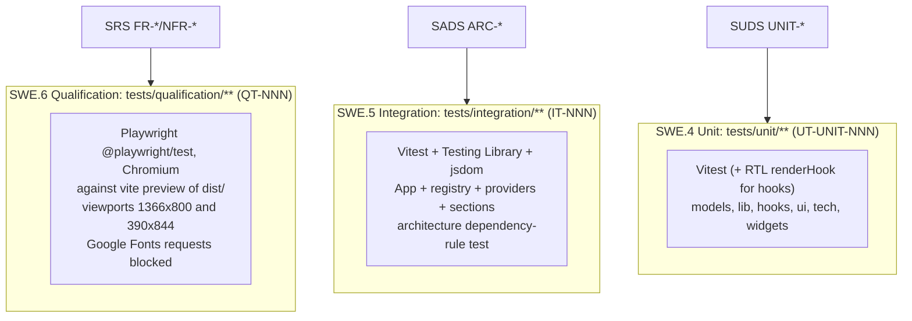

| Level | Basis | Scope and typical cases | Environment | Command |
|---|---|---|---|---|
| Unit (SWE.4) | SUDS `UNIT-*` | `validate.js` assertions. Every `create*` factory (happy path, each missing field, freezing). `solar.getSunPhase` at fixed dates and times, including boundaries. `mulberry32` determinism. `createParticles` ranges. `parseIconRef`. Speedometer geometry. `pickActiveSection`. Each hook with `renderHook` and fake timers. `Icon`, `Button`, `Section`, `TechIcon` strategies including the `onError` fallback. | Vitest, jsdom, `@testing-library/jest-dom` matchers | `npm test` |
| Integration (SWE.5) | SADS `ARC-*` and the interfaces in section 5 | `App` renders all registry sections in order with dividers. `Nav` items equal `NAV_ITEMS`. The theme toggle changes `html[data-theme]` through the context. Lazy sections resolve and reveal elements get `.visible`. The section ErrorBoundary contains a throwing section and a rejected lazy import. Every `svg:` key and `artKey` resolves. All `a[target=_blank]` carry `rel="noopener noreferrer"`. **Dependency-rule test** (section 4.3.2). **Parity tests:** DOM snapshot vs. baseline, CSS equivalence vs. baseline. | Vitest, RTL, jsdom with IO/matchMedia stubs | `npm test` |
| Qualification (SWE.6) | SRS `FR-*`, `NFR-*` | Black-box against the production build: all sections visible after scroll, nav anchors scroll and highlight, mobile menu, theme toggle and time-based theme (`page.clock`), resume link returns 200 `application/pdf`, internal anchors resolve, landmarks, alt text, keyboard traversal, `prefers-reduced-motion` emulation, SEO meta, and screenshot-based visual regression at both viewports against baselines taken from the monolith. External requests to Google Fonts are blocked for determinism. Simple Icons is blocked or routed to a fixture. | `@playwright/test` (Chromium) + `vite preview` webServer | `npm run test:qualification` |

- **Coverage targets:** at least 90 % lines for `models/`, `lib/` and `hooks/`, and at least 80 % overall, via `npm run test:coverage` (Vitest's built-in v8 provider).
- **Naming:** every test title starts with its ID (`UT-<UNIT>-NNN`, `IT-NNN`, `QT-NNN`) for STP traceability.
- **CI:** the `build` job runs `lint`, `test` and `build`. A `qualification` job runs after it, installs Chromium and runs `test:qualification`. Visual baselines are committed under `tests/qualification/__screenshots__/` and generated on the CI's Linux image, to avoid font-rendering differences between operating systems.

---

## 9. Architecture Decision Records (ADR)

Format: Context, Decision, Alternatives considered, Consequences. Status is **Accepted** unless noted.

### ADR-001 Keep plain JavaScript with JSDoc types (no TypeScript)

- **Context:** The repo is plain JSX (C-1). Domain models benefit from types. The brief fixes plain JS, and a migration to TypeScript would multiply the change surface during a parity refactor.
- **Decision:** Stay on JavaScript. Declare every model as a JSDoc `@typedef` in `models/types.js`. Annotate public functions and hooks with `@param` and `@returns`. Runtime validation (ADR-009/010) provides the guarantees that matter for data.
- **Alternatives:**
  - TypeScript (`.tsx`): rejected because of new toolchain dependencies and churn.
  - `// @ts-check` with `jsconfig.json`: allowed as an optional editor-only aid, but not a CI gate.
- **Consequences:** No build change and editor IntelliSense via JSDoc, but there is no compile-time enforcement. Validators and tests compensate.

### ADR-002 External CSS files split by layer instead of a CSS-in-JS string

- **Context:** P-02. The 910-line string lives in JS, renders only after JS executes, blocks a strict CSP and cannot be cached separately.
- **Decision:** Move the CSS verbatim into `styles/tokens.css`, `base.css`, `components.css` and `sections.css`, aggregated by `styles/index.css` and imported once in `main.jsx`. Vite extracts it to a hashed `.css` asset. Rule text and values are unchanged, and the order constraints in section 8.1 hold.
- **Alternatives:**
  - CSS Modules: rejected because they rename classes and break the parity requirement for class names.
  - A CSS-in-JS library: rejected as a new runtime dependency.
  - Keeping the string: rejected for the reasons in P-02.
- **Consequences:**
  - (+) Styles apply before JS. CSS is cacheable. CSP is possible.
  - (+) The JS entry shrinks by about 45 kB raw.
  - (−) Global CSS remains global, which is accepted. The cascade order needs a test.

### ADR-003 React Context for theme instead of prop drilling

- **Context:** The theme is owned by `App` and drilled into `Nav` (line 2440). Future consumers, such as the footer or the speedometer palette, would need more drilling.
- **Decision:** `ThemeProvider` (ARC-008) owns `useTheme` and exposes a memoised `{theme, isDay, toggle, now}`. Components call `useThemeContext()`.
- **Alternatives:**
  - Prop drilling: works today but couples `App` to every consumer.
  - An external store (Zustand or Redux): a new dependency (C-2) and overkill.
  - Reading `document.documentElement.dataset.theme` directly: not reactive.
- **Consequences:** Single ownership and easy test injection. Consumers re-render on each change, which happens at most once per minute.

### ADR-004 Configuration-driven section registry

- **Context:** P-16. Order, nav and headings are duplicated in three places. Design art and icons are JSX inside data (P-13).
- **Decision:** `config/sections.js` exports an ordered, frozen `SECTIONS` array (`id, label, heading, icon, number, component, lazy, showInNav, minHeight`) and the derived `NAV_ITEMS`. `App` renders by mapping `SECTIONS`. `Nav` renders `NAV_ITEMS`. The same Registry pattern is used for `CUSTOM_SVGS` and `DESIGN_ART` (data stores keys).
- **Alternatives:**
  - Hard-coded JSX order, the status quo.
  - File-system discovery via `import.meta.glob`: implicit ordering and less explicit.
- **Consequences:** One edit adds or reorders a section, and the headings "NN — X" are generated. Registry and section ids must match, which an integration test asserts.

### ADR-005 React.lazy + Suspense for below-the-fold sections; Hero and Nav eager

- **Context:** QA-1. There is a single 84.8 kB gzip chunk. Only Hero is visible on first paint.
- **Decision:**
  - Hero, Nav, the effects and the Speedometer are eager.
  - The other nine sections use `React.lazy(() => import(...))`. Each is wrapped in its own `ErrorBoundary` + `Suspense` with a placeholder that keeps `id`, `data-section` and `minHeight`.
  - All lazy imports start right after the first commit. They are not scroll-triggered.
  - `useHashScroll` re-applies the URL hash after its target mounts.
- **Alternatives:**
  - No splitting: simplest, but does not meet "lazy sections should reduce initial chunk".
  - On-scroll (IO-triggered) loading: breaks anchor navigation and find-in-page and adds pop-in.
  - A single Suspense for all sections: one slow chunk would hold back every section.
- **Consequences:**
  - (+) Smaller initial JS. Failures are isolated per section.
  - (−) A brief placeholder on slow networks.
  - (−) Reveal must be per-section (ADR-012).
  - (−) Stale chunk risk after a redeploy, handled by the boundary's reload.

### ADR-006 Vitest + Testing Library + jsdom for unit and integration tests

- **Context:** There are no tests (P-20). The toolchain is Vite.
- **Decision:** Use Vitest (shares Vite config and transforms, ESM-native), `@testing-library/react` and `@testing-library/jest-dom`, with a jsdom environment. `tests/setup.js` registers the matchers and the IO, matchMedia and rAF stubs. Scripts: `"test": "vitest run"`, `"test:coverage": "vitest run --coverage"`. ESLint gets a `tests/**` override with Vitest globals, or tests use explicit imports.
- **Alternatives:**
  - Jest: needs Babel or SWC configuration for ESM and JSX.
  - happy-dom: faster but less complete.
  - Cypress component testing: heavy.
- **Consequences:** Fast feedback that reuses the Vite pipeline. jsdom has no layout, so `offsetTop` is stubbed and layout and visual checks are delegated to Playwright (ADR-016).

### ADR-007 Seeded PRNG for particles

- **Context:** P-06. `Math.random()` at module load makes particles non-deterministic, so snapshot and visual tests are impossible.
- **Decision:** `lib/random.js` provides `mulberry32(seed)` (a pure 32-bit PRNG, about 10 lines). `Particles` uses `createParticles(18, mulberry32(PARTICLE_SEED))` with a fixed constant seed. The field formulas are unchanged. Typewriter jitter takes an injectable `rng` that defaults to `Math.random`.
- **Alternatives:**
  - Keeping `Math.random` and mocking it in tests: production would still vary per load, and visual tests would still flake.
  - Hard-coding 18 particle literals: works but is opaque.
- **Consequences:**
  - (+) Deterministic visuals and testable output.
  - (−) Particle positions no longer vary between page loads. This is accepted: the visual character (count, ranges, colours) is unchanged, and SRS FR-FX-* states the ranges, not randomness.

### ADR-008 No new runtime dependencies

- **Context:** C-2. Bundle budget QA-1. Supply-chain surface.
- **Decision:** Runtime dependencies stay `react` and `react-dom`. Validation, PRNG, solar maths, the registry and the error boundary are implemented in-house in small pure modules. Allowed dev dependencies are vitest, @testing-library/react, @testing-library/jest-dom, jsdom and @playwright/test (ADR-016). The coverage provider is `@vitest/coverage-v8` if `vitest --coverage` requires it, and it is a dev-only addition.
- **Alternatives:** zod or yup for validation, seedrandom, suncalc, react-error-boundary. All were rejected as runtime additions.
- **Consequences:** A tiny bundle and full control, at the cost of a little more code to own and test.

### ADR-009 Domain models as frozen plain objects produced by factory functions

- **Context:** Data needs structure, validation and immutability, while staying serialisable and React-free.
- **Decision:** `create<Model>(raw)` validates, applies defaults and returns a deep-frozen plain object, typed by JSDoc. No classes are used.
- **Alternatives:**
  - ES classes with constructors: identity and prototype overhead, awkward to spread.
  - Untyped literals, the status quo.
- **Consequences:** Simple objects that work directly as React props and keys. Immutability is enforced at runtime.

### ADR-010 Fail-fast content validation at module evaluation, gated by CI

- **Context:** Invalid data must never reach production. It is unclear whether production should warn or throw.
- **Decision:** Factories **throw** `ModelValidationError` in all environments. Every data module is imported by unit tests, so CI fails before deploy. Lazy section data failures surface to the section `ErrorBoundary`. Eager data, such as `profile.js`, would fail module evaluation and blank the page. That is prevented by the CI gate and by the deploy procedure (deploy only from a green `main`).
- **Alternatives:**
  - Warn-only in production: renders partially broken content silently.
  - Validation only in tests: a second code path, and data could bypass it.
- **Consequences:** Strong guarantees with one code path. Deploy discipline is required because `npm run deploy` is a manual command. STP adds a pre-deploy checklist item.

### ADR-011 Pure solar module with the corrected algorithm (SRS v1.1 FR-THEME-002)

*Revised in v1.1. The v1.0 decision to preserve the sign error was superseded by the Product Owner decision (PO-REV F-03, F-04; OBS-2, OBS-16).*

- **Context:** P-05 and P-23. The sunrise and sunset logic is embedded in the hook and is untestable. It also has three defects:
  1. **Sign error.** The longitude correction has the wrong sign: `80.27/15 − 5.5 ≈ −0.1487 h`. Chennai (80.27° E) lies west of the IST meridian (82.5° E), so local solar noon is about 12:09 IST and the correction must be `5.5 − 80.27/15 ≈ +0.1487 h`. The baseline switches about 18 min early.
  2. **Day-of-year rollover.** The day-of-year is a rounded difference against `new Date(year, 0, 0)`, so it advances at about 12:00 IST.
  3. **Time-zone dependence.** IST is derived through `getTimezoneOffset()` and local getters, which depend on the browser time zone and DST.
- **Decision:** Extract `getSunPhase(date, geo)` to `lib/solar.js` (ARC-007) and implement SRS v1.1 FR-THEME-002 exactly:
  - (1) IST wall clock = UTC epoch ms + 5.5 h, read **with UTC getters only**.
  - (2) `dayOfYear` = the IST calendar day number (1 on 1 January), **changing at 00:00 IST**.
  - (3)-(5) Unchanged declination, hour angle and sunrise/sunset formulas.
  - (6) `LONGITUDE_CORRECTION_H = 5.5 − 80.27/15` (≈ **+0.1487 h**). The source comment states this value and its derivation.
  - (7) `day` iff `sunrise + c ≤ hourIST < sunset + c`.
  - The function takes the instant as a parameter, with no `new Date()` inside, so tests can inject dates.
- **Verification:**
  - Unit tests assert the SRS acceptance values: the day-172 window is about 05:46 to 18:32 IST and the day-355 window is about 06:32 to 17:46 IST (±1 min). The constant equals +0.14867 to 4 decimals. Noon and midnight rollover behave as specified. The results are identical when run under `TZ=UTC`, `TZ=Asia/Kolkata` and `TZ=America/New_York` near a DST change.
  - A comparison against the baseline implementation over a 365 d × 1440 min grid shows differences **only** in the expected bands around sunrise and sunset. This is the documented parity deviation under NFR-MAINT-008.
- **Alternatives:**
  - Preserving the baseline arithmetic (the v1.0 decision): rejected by the PO because only the switch time changes and the fix is cheap.
  - A full NOAA solar algorithm with the equation of time: more accurate, but not required. The SRS keeps the approximate model.
- **Consequences:**
  - (+) The switch times are closer to real Chennai sunrise and sunset. The result does not depend on the visitor's time zone. The logic is fully unit-testable.
  - (−) The theme at a given instant near sunrise or sunset differs from the baseline. Qualification screenshots therefore use fixed clock instants away from the switch bands, such as 12:00 and 23:00 IST.
- **Related:** applying the result before first paint is ADR-017. Persistence of manual choices is ADR-018.

### ADR-012 Per-section reveal observer instead of a global, dependency-less effect

- **Context:** P-03. The global `useReveal()` in `App` re-queries the document after each `App` render and never sees nodes mounted later by lazy sections.
- **Decision:** `useReveal(rootRef)` is called by the `Section` wrapper, and by the sections that do not use the wrapper's root, with an effect keyed on the ref. It observes `.reveal` descendants of that root with the same threshold (0.06) and class behaviour. The global call in `App` is removed.
- **Alternatives:**
  - A global MutationObserver plus IO: more complex, and it observes the entire document.
  - A per-element `useRevealRef()` on every `.reveal` node: many observers and invasive markup changes.
- **Consequences:** Correct with lazy loading, and one observer per section, created once. Hero has no `.reveal` elements and is unaffected.

### ADR-013 Content Security Policy via meta tag, injected at build time

- **Context:** QA-9. GitHub Pages cannot set response headers.
- **Decision:** Inject the policy from section 8.6 as `<meta http-equiv="Content-Security-Policy">` into `dist/index.html` only, using an inline Vite plugin (`transformIndexHtml`, `apply: 'build'`). This depends on ADR-002 (no inline `<style>`) and ADR-017 (theme applied by React, so no inline script). Qualification tests assert there are no CSP violations: a Playwright `page.on('console')` check for CSP errors.
- **Alternatives:**
  - No CSP: the status quo.
  - Hosting behind Cloudflare or Netlify for real headers: violates C-4.
- **Consequences:**
  - (+) Reduced XSS and exfiltration surface. Third-party origins are enumerated.
  - (−) `frame-ancestors` and reporting are unavailable.
  - (−) Adding a new external origin requires a policy update. The allow-list is documented in ARC-018.

### ADR-014 Keep Simple Icons CDN at runtime with strategy-level fallback

- **Context:** Skill logos come from `cdn.simpleicons.org` (line 1445). Bundling them would need either the `simple-icons` package (a large dependency) or vendored SVGs, and the colours and rendering would change.
- **Decision:**
  - Keep runtime CDN loading inside the `si` strategy, with the existing `onError` fallback to `Icon("code")`.
  - Add `loading="lazy"` and `decoding="async"`, which are invisible changes. Skills is lazy anyway.
  - Keep `alt` = slug, as NFR-A11Y-004 requires (v1.1; v1.0 had proposed `alt=""`).
  - The origin is whitelisted in CSP `img-src`.
- **Alternatives:**
  - Vendoring the about 20 SVGs into `public/icons/`: removes the third-party dependency, but CDN-coloured output would differ, which is a parity risk. It is recorded as a future option.
- **Consequences:** A third-party availability and privacy dependency remains. It degrades gracefully. Qualification tests route the CDN to fixtures for determinism.

### ADR-015 Honour prefers-reduced-motion in JavaScript-driven motion

- **Context:** The CSS block (lines 908-916) disables CSS animation, but JS-driven motion still runs: the speedometer rAF, the parallax transform, the cursor-glow listener and the typewriter.
- **Decision:** `usePrefersReducedMotion()` (ARC-009) gates the JS motion:
  - The Speedometer renders a static frame (t=0) and starts no rAF.
  - `useParallax({enabled:false})` attaches no listener.
  - `CursorGlow` is not mounted. It is `display:none` under reduced motion already, so this is visually identical.
  - `useTypewriter({enabled:false})` returns `HERO_ROLES[0]` statically.
- **Alternatives:** CSS only, the status quo. It leaves JS motion and CPU usage in place.
- **Consequences:** Better A11Y and battery behaviour (NFR-A11Y-002). For users without the preference, behaviour is unchanged, so parity holds for the default case. Visibility gating of the gauge for all users is the separate decision ADR-019. Reduced-motion behaviour is a documented, intentional deviation, mapped to NFR-A11Y-*.

### ADR-016 Playwright-based qualification testing against the production build

- **Context:** The brief defines three ASPICE levels. Requirement-level (SWE.6) verification needs a real browser: layout, CSS cascade, IntersectionObserver, media emulation, screenshots and real chunk loading. jsdom cannot provide these.
- **Decision:**
  - Use `@playwright/test` (dev dependency, Chromium project only), with tests in `tests/qualification/**` and IDs `QT-NNN`.
  - `playwright.config.js` starts `npm run build && npm run preview` (`vite preview`, port 4173) as `webServer`.
  - Two projects: desktop 1366x800 and mobile 390x844.
  - Route-block `fonts.googleapis.com` and `fonts.gstatic.com` for offline-safe, deterministic rendering. Route `cdn.simpleicons.org` to local fixtures.
  - Use `page.clock` to pin the time for theme tests and `page.emulateMedia({reducedMotion:'reduce'})` for motion tests.
  - Use `expect(page).toHaveScreenshot()` for visual regression, with baselines generated from the monolith build (migration step 0).
  - Script: `"test:qualification": "playwright test"`. CI runs it as a separate job after `build`.
- **Alternatives:**
  - Cypress: heavier, and multi-viewport and visual diffing need plugins.
  - Manual testing only: not repeatable and not traceable.
  - Vitest browser mode: still immature for screenshot baselines.
- **Consequences:**
  - (+) Objective pixel-parity evidence and full SRS traceability.
  - (−) Longer CI time (Chromium install) and baseline maintenance when visuals legitimately change.
  - (−) Font blocking means screenshots use fallback fonts. They are consistent between baseline and candidate, which is what parity needs.

### ADR-017 Apply the theme before first paint through ThemeProvider initial state and a layout effect

- **Context:** FR-THEME-001 (OBS-17, F-05). The baseline writes `data-theme` in a passive `useEffect` (lines 955-957), which runs after the browser has painted. A day-time visitor sees one night frame of the rendered app. CSP (ADR-013) forbids an inline pre-hydration script (`script-src 'self'`, no hash).
- **Options:**
  1. An inline `<script>` in `index.html` that sets `data-theme` before any CSS paint.
  2. Set `data-theme` synchronously in `main.jsx` before `createRoot().render()`.
  3. `ThemeProvider` computes the initial theme in a lazy `useState` initializer and writes the attribute in `useLayoutEffect`.
- **Decision:** Option 3.
  - `useTheme` computes its initial state once with `readThemeOverride() ?? getSunPhase(new Date())`.
  - It writes `document.documentElement.dataset.theme` in `useLayoutEffect([theme])`. Layout effects run synchronously after React commits the DOM and **before** the browser paints that commit, so the first painted frame of the app already has the correct tokens.
  - The same layout effect handles later changes (toggle, auto switch), so one effect owns the attribute.
- **Justification:**
  - Option 1 is rejected because it violates CSP ADR-013, or needs a hash that must be maintained.
  - Option 2 meets FR-THEME-001 equally well, but it duplicates the decision logic outside the provider. There would then be two writers of `data-theme`, two places that read storage, and a risk of disagreement under StrictMode or tests. Its only extra benefit is covering the short gap between module evaluation and React's first commit, during which `#root` is still empty.
  - **Residual:** before the JS executes, the browser may paint the empty page with the `:root` (night) background. No CSP-compatible approach can avoid that, and FR-THEME-001 scopes the requirement to the rendered app. It is accepted.
- **Verification:** IT: the attribute is set when the provider's first layout effect has run, before any passive effect. QT: an init script records `data-theme` in the first rAF after `#root` gains children, with a mocked daytime clock, and it reads `day` (per the FR-THEME-001 acceptance criteria).
- **Consequences:**
  - (+) A single owner and no inline script.
  - (−) `useLayoutEffect` warns during server rendering, which is not used (CSR only). Tests run in jsdom, where it behaves like `useEffect` but still runs before the test's assertions.

### ADR-018 Persist the manual theme override in localStorage through a guarded accessor

- **Context:** FR-THEME-008 (OBS-3, F-06). The baseline override is lost on reload. The PO approved persistence as a per-viewer convenience, with a guarded fallback.
- **Decision:**
  - A new unit, `src/lib/storage.js` (ARC-007), exposes `readThemeOverride(storage?)` and `writeThemeOverride(theme, storage?)`.
  - The key is `THEME_STORAGE_KEY = "jsv-theme-override"` (ARC-003). The value is `"day"` or `"night"`.
  - Every `localStorage` access, including the property lookup on `globalThis` (which can throw when site data is blocked), is inside try/catch.
  - A read returns `null` for a missing value, an invalid value or an exception. A write returns `false` on failure and never throws.
  - `useTheme` reads once for its initial state. A valid value counts as an active manual override, so no theme interval is started (FR-THEME-003). Each toggle writes the new value. Nothing else is stored, and the override is never cleared automatically.
- **Alternatives:**
  - `sessionStorage`: does not survive a browser restart, which falls short of FR-THEME-008.
  - Cookies: sent to the server for nothing, and a consent question.
  - A query parameter: not sticky.
  - Ungarded `localStorage` access: throws in some private modes and blocked-storage configurations.
- **Consequences:**
  - (+) The chosen theme survives reloads. Every failure mode degrades to the automatic theme with no console error. The accessor is unit-testable with an injected stub.
  - (−) A visitor who once toggled never gets automatic switching again in that browser unless they clear site data. This is accepted by FR-THEME-008, which defines no reset control.

### ADR-019 Gate the speedometer animation loop on visibility

- **Context:** NFR-PERF-006 (OBS-18, F-13). The baseline loop (lines 1743-1753) calls `setState` twice per frame, forever, including at 900 px or less where `.hero-center` is `display: none`, when the gauge is scrolled away, and in background tabs. Browsers throttle rAF in hidden tabs, but the React re-renders still run when frames fire, and nothing stops the loop on visible but scrolled-away pages.
- **Decision:**
  - A new unit, `src/hooks/useInView.js` (ARC-009), combines an IntersectionObserver on the gauge's `<svg>` (threshold 0) with `visibilitychange`, and returns one boolean.
  - `Speedometer` keeps `t` in a ref and runs an effect keyed on `[inView, reducedMotion]`. When the gauge is in view and reduced motion is off, it requests a frame. Otherwise it cancels the frame and schedules nothing.
  - The last rendered frame stays on screen, so there is no visual change. When the gauge becomes visible again, the loop resumes from the current `t`.
  - `display: none` produces no intersection, so no `matchMedia("(max-width: 900px)")` is needed. That keeps the CSS breakpoint the single source of truth.
- **Alternatives:**
  - Pausing only on `visibilitychange`: misses the mobile case, which is the main battery concern.
  - A matchMedia check on the 900 px breakpoint: duplicates the CSS breakpoint in JS.
  - Driving the needle via CSS animations: a rewrite of the widget, with parity risk.
  - Writing SVG attributes imperatively without React state: an optimisation that is not needed once gated, with more parity risk.
- **Consequences:**
  - (+) Zero rAF calls at 390x844, which QT verifies with an rAF-counting init script. The loop stops after scrolling to `#contact`.
  - (+) `useInView` is reusable, but is used only by the gauge in this release.
  - (−) Without IntersectionObserver the gauge always animates, the baseline behaviour, while document visibility is still honoured.

### ADR-020 Skip link and keyboard-only `:focus-visible` indicator

- **Context:** NFR-A11Y-008 and NFR-A11Y-009 (OBS-15, F-10, F-11). There is no bypass mechanism, and focus relies on weak browser defaults. Pointer visuals must keep parity (NFR-MAINT-008).
- **Decision:**
  - **Skip link.** `App` (ARC-002) renders `<a className="skip-link" href="#main">Skip to content</a>` as the first child, before the effects and `Nav`. `<main>` gets `id="main"` and `tabIndex={-1}`, so following the link moves focus there natively, with no JS.
    - CSS in `components.css`: `.skip-link` is visually hidden by default, using an off-screen position rather than `display: none`, so it stays focusable.
    - `.skip-link:focus` moves on-screen at the top left with `z-index: 301` (above the nav's 300) and uses theme tokens (`--glass-bg`, `--amber`, `--mono`).
  - **Focus indicator.** CSS in `base.css`, appended after the existing rules:
    - `a:focus-visible, button:focus-visible { outline: 2px solid var(--amber); outline-offset: 2px; }`
    - `:focus:not(:focus-visible) { outline: none; }`
    - This applies to links, buttons and link cards (`.behance-card`) in both themes through the `--amber` token. Pointer focus shows nothing new.
- **Alternatives:**
  - A JS-managed skip link or focus ring (`keydown` tracking): `:focus-visible` is supported by every target browser.
  - Applying `:focus` styles to everything: changes pointer visuals and breaks parity.
  - Making the skip link always visible: a visual change.
- **Consequences:**
  - (+) Meets WCAG 2.4.1 and 2.4.7 with no change to screenshots taken without keyboard focus.
  - (−) Two new CSS rule groups, allow-listed in the CSS-equivalence test (ARC-017).
  - (−) `<main tabindex="-1">` may show a focus ring when focused programmatically. `:focus:not(:focus-visible)` suppresses it for that case in current browsers.

### ADR-021 Reveal fallback when IntersectionObserver is unavailable

- **Context:** NFR-RELI-005 (F-12). `.reveal` starts at `opacity: 0` (CSS lines 536-537). Without IntersectionObserver, which can be missing on old browsers, in some embedded webviews and in locked-down environments, all reveal content would stay invisible to a recruiter.
- **Decision:** `useReveal(rootRef)` checks `typeof window !== "undefined" && "IntersectionObserver" in window`. If the API is missing, it adds `visible` to every `.reveal` element under the root synchronously in its effect, and creates no observer. Construction of the observer is also wrapped in try/catch with the same fallback. It never throws. The same check makes `useInView` report `true` (ADR-019).
- **Alternatives:**
  - A `@supports`-style CSS-only fallback: CSS cannot detect a JS API.
  - A `<noscript>`-style class on `<html>`: it would need an inline script, which ADR-013 forbids.
  - A polyfill: a new dependency, which C-2 forbids.
- **Consequences:**
  - (+) Content is always visible.
  - (−) There is no animation in the fallback case, which is acceptable.
  - (+) This also simplifies jsdom tests: without a stub, reveal elements become visible.

### ADR summary

| ADR | Title | Status |
|---|---|---|
| ADR-001 | Keep plain JavaScript with JSDoc types (no TypeScript) | Accepted |
| ADR-002 | External CSS files split by layer instead of a CSS-in-JS string | Accepted |
| ADR-003 | React Context for theme instead of prop drilling | Accepted |
| ADR-004 | Configuration-driven section registry | Accepted |
| ADR-005 | React.lazy + Suspense for below-the-fold sections; Hero and Nav eager | Accepted |
| ADR-006 | Vitest + Testing Library + jsdom for unit and integration tests | Accepted |
| ADR-007 | Seeded PRNG for particles | Accepted |
| ADR-008 | No new runtime dependencies | Accepted |
| ADR-009 | Domain models as frozen plain objects produced by factory functions | Accepted |
| ADR-010 | Fail-fast content validation at module evaluation, gated by CI | Accepted |
| ADR-011 | Pure solar module with the corrected algorithm (SRS v1.1 FR-THEME-002) | Accepted (revised in v1.1) |
| ADR-012 | Per-section reveal observer instead of a global, dependency-less effect | Accepted |
| ADR-013 | Content Security Policy via meta tag, injected at build time | Accepted |
| ADR-014 | Keep Simple Icons CDN at runtime with strategy-level fallback | Accepted |
| ADR-015 | Honour prefers-reduced-motion in JavaScript-driven motion | Accepted |
| ADR-016 | Playwright-based qualification testing against the production build | Accepted |
| ADR-017 | Apply the theme before first paint through ThemeProvider initial state and a layout effect | Accepted (v1.1) |
| ADR-018 | Persist the manual theme override in localStorage through a guarded accessor | Accepted (v1.1) |
| ADR-019 | Gate the speedometer animation loop on visibility | Accepted (v1.1) |
| ADR-020 | Skip link and keyboard-only `:focus-visible` indicator | Accepted (v1.1) |
| ADR-021 | Reveal fallback when IntersectionObserver is unavailable | Accepted (v1.1) |

---

## 10. Migration plan, risks and mitigations

### 10.1 Ordered migration steps

Each step leaves the app building, linting and visually identical. Steps 0-2 establish the safety net before any code moves.

| Step | Action | Exit criterion |
|---|---|---|
| 0 | **Baseline capture** at `dd9a86d`. Record the build sizes (304.14 kB / 84.79 kB gzip). Add Playwright and generate screenshot baselines of the monolith (desktop and mobile, top of each section, both themes via `page.clock`, particles masked because they are random in the baseline). | Baselines committed. Size recorded in STP. |
| 1 | **Test infrastructure.** Add Vitest, RTL, jest-dom and jsdom, plus `tests/setup.js` (IO, matchMedia and rAF stubs). Add the scripts `test`, `test:coverage` and `test:qualification`. Add the `npm test` step to CI and the qualification job. Add the ESLint override for tests. | `npm test` passes, with a smoke test rendering `App`. |
| 2 | **Parity fixtures.** (a) Extract the baseline `CSS` string to `tests/fixtures/baseline.css`. (b) Generate a DOM snapshot of the monolith rendered in jsdom with mocked `Math.random`, fixed time and all `.reveal` made visible, saved to `tests/fixtures/baseline-dom.html`. Write the CSS-equivalence and DOM-parity integration tests. They normalise whitespace and ignore particle inline styles. They allow-list exactly the parity deviations listed in NFR-MAINT-008: added `aria-*` attributes, the skip link, `main#main[tabindex]`, `download` filenames, and the `.skip-link` and `:focus-visible` CSS. | Both parity tests pass against the monolith itself. |
| 3 | **Styles.** Move the CSS into `styles/*.css` per section 8.1. Import `styles/index.css` in `main.jsx`. Remove `<style>{CSS}</style>`. | CSS-equivalence test passes. Screenshots match. |
| 4 | **Pure core.** Create `lib/solar.js` with the corrected FR-THEME-002 algorithm (ADR-011), `lib/random.js` and `lib/storage.js`. Refactor `useTheme` and `Particles` to use them. Unit tests use fixed dates, seeds and a storage stub. Re-baseline the particle region of the screenshots once (ADR-007). | Unit tests pass, including the SRS window values and the multi-time-zone runs. Against the inline implementation over a 365 d × 1440 min grid, decisions differ only in the expected sunrise and sunset bands. |
| 5 | **Models.** Add `models/` (types, validate, factories) with unit tests. | At least 90 % coverage for models. |
| 6 | **Config and data.** Add `config/site.js`. Move all data into `data/*.js` through the factories, including content currently literal in JSX (P-14) and `artKey`s (P-13). The monolith components now import from the data modules. | DOM-parity test passes. |
| 7 | **Hooks and context.** Move the hooks to `hooks/`. Add `usePrefersReducedMotion`. Change `useReveal` to the per-root form (ADR-012), still called from `App` with a root ref on `<main>` until sections are split. Add `useInView`. Add `ThemeContext` with the layout-effect attribute write (ADR-017) and override persistence (ADR-018), and make `Nav` consume it, including the ticking clock. Add the IO fallback in `useReveal` (ADR-021). | Hook unit tests pass. DOM parity holds. |
| 8 | **Primitives and components.** Extract `ui/`, `tech/` (strategies, `CUSTOM_SVGS`), `effects/`, `widgets/`, `layout/` and `ErrorBoundary`. Add the `aria-hidden` and `aria-expanded` attributes (accepted parity deltas, whitelisted in the DOM-parity normaliser). | Unit tests pass. Screenshots match. |
| 9 | **Sections.** Extract the ten `sections/*.jsx` files, each default-exported, all still imported eagerly. Introduce the `Section` wrapper with `as` to keep the `div`/`section` element types. | DOM parity and screenshots hold. |
| 10 | **Registry.** Add `config/sections.js`. `App` and `Nav` render from it, and headings derive from it. | Integration tests: order, nav and headings. |
| 11 | **Code splitting.** Switch the nine sections to `React.lazy`. Add the per-section `ErrorBoundary` + `Suspense` + placeholder and `useHashScroll`. Remove the global `useReveal` from `App`. | The build shows separate chunks. Initial JS gzip is at or below the baseline. Qualification deep-link (`/#contact`) and reveal tests pass. |
| 12 | **Performance and A11Y refinements.** Speedometer visibility gate (ADR-019), rAF coalescing, reduced-motion gating (ADR-015), skip link and `:focus-visible` (ADR-020), Escape for the mobile menu (FR-NAV-012), unified resume `download` filename (P-25). | Qualification rAF-count, reduced-motion, skip-link, focus-visible and keyboard checks pass. Screenshots without focus match the baseline. |
| 13 | **Hardening.** Add the import-boundary ESLint rules and the architecture test. Add the CSP plugin (ADR-013). Reach the coverage targets. | `npm run lint`, `npm test`, `npm run build` and `npm run test:qualification` are all green in CI. |
| 14 | **Release.** Merge to `main`. CI is green. `npm run deploy`. Smoke-check production (QT smoke subset against the live URL, optional). | Live site matches the baselines. |

### 10.2 Risks and mitigations

| ID | Risk | Likelihood / Impact | Mitigation |
|---|---|---|---|
| R-1 | **Visual regression from CSS split** (cascade order change, a missed rule) | Med / High | CSS-equivalence test against the baseline fixture (step 2). Ordering rules in section 8.1. Playwright screenshot diffs at 2 viewports × 2 themes. |
| R-2 | **Accidental "fixes" change visuals**, for example forwarding `className="ms"` to `Icon` would activate the dormant `.nav-link .ms` and `.btn .ms` rules (P-08) | Med / Med | Parity first: `Icon` does not add `.ms`. Any intended deviation needs an ADR or SRS change and a re-baselined screenshot. |
| R-3 | **Reveal content stays invisible in lazy sections** | High if unaddressed / High | ADR-012 per-section observer. Integration test asserting `.visible` after lazy resolve. Qualification scroll test. |
| R-4 | **Hash deep links land at the wrong position** before lazy content mounts | Med / Med | Placeholders carry `id` and `minHeight`. `useHashScroll` re-scrolls after mount. QT for `/#projects` and `/#contact`. |
| R-5 | **Layout shift (CLS) from Suspense placeholders** | Med / Low | Registry `minHeight` per section, approximated from the baseline section heights. Chunks load immediately after the first commit. |
| R-6 | **Stale chunks after redeploy** (CDN caches `index.html` for 10 min, so old hashes return 404) | Low / Med | `gh-pages` replaces the branch content. The section `ErrorBoundary` offers a reload. Optionally keep previous assets with `gh-pages --add`, which is a documented option but not the default. |
| R-7 | **Theme flash or regression** from `useLayoutEffect`, context, persistence and the corrected solar algorithm | Low / Med | Unit tests with fixed instants and SRS window values. QT with `page.clock` at 12:00 and 23:00 IST for screenshots, plus boundary checks. Storage cleared before each QT. Tests with storage throwing or holding an invalid value. The `data-theme` value set is unchanged (`day`/`night`). |
| R-8 | **StrictMode double-invocation** creates duplicate observers, intervals or rAF loops in dev | Med / Low | Every effect has a symmetric cleanup. Hook tests run under StrictMode wrappers. |
| R-9 | **Content drift during the move** (typos, missing items) | Med / High | DOM-parity snapshot (text-exact). Factory validation. Item-count invariants (section 7). |
| R-10 | **Bundle grows** (for example, the registry pulls lazy sections eagerly through a static import) | Low / Med | Only dynamic `import()` in `config/sections.js`. The architecture test forbids static imports of lazy sections. CI prints the size, and STP tracks the budget. |
| R-11 | **Lint failures** from `react-refresh/only-export-components` when a module exports components and constants together | Med / Low | Keep registries (`CUSTOM_SVGS`, `ICON_STRATEGIES`) in non-component modules (`.js`) or allow-list them. One default component export per section file. |
| R-12 | **Flaky tests** (timers, rAF, CDN, fonts) | Med / Med | Fake timers. Seeded RNG. jsdom stubs. Playwright blocks fonts and routes Simple Icons to fixtures. Animations disabled in screenshot tests via `reducedMotion` or the `animations: 'disabled'` option. |
| R-13 | **CSP breaks something** (an origin or inline usage overlooked) | Low / High | CSP is added last (step 13). A Playwright test fails on any CSP console error. The meta tag is build-only. |
| R-14 | **Reduced-motion change perceived as a regression** | Low / Low | It is limited to users with the preference set, documented in ADR-015 and mapped to an NFR-A11Y requirement. |
| R-15 | **Manual deploy from an unverified tree** | Low / High | Release step 14: deploy only from a green `main`. A future option is a CI-driven deploy job, which would be outside the current C-4 scope. |
| R-16 | **Persisted override confuses testing or support** ("the theme does not follow the sun") | Med / Low | QT clears `localStorage` in `beforeEach`. STP documents the key `jsv-theme-override`. The behaviour is specified by FR-THEME-008. |
| R-17 | **Gauge never animates on desktop** if `useInView` misreports, for example because the observer targets an element that has zero size during the first layout | Low / Med | Observe the `<svg>`, which has an intrinsic viewBox size. UT for the hook. QT at 1366x800 asserts that the rAF count increases while the hero is in view. |

---

*End of SADS.*
